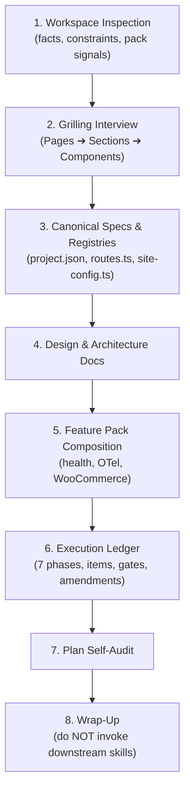

# Next.js Project Planning Skill (`nextjs-plan`)

Turns a workspace and an interview into canonical specifications
(`docs/project.json`), type-safe registries (`lib/`), design/architecture contracts
(`docs/design/`), and a **7-phase execution ledger** in `docs/plan/` that any agent
can resume from. Optional capability tracks (**feature packs**) compose into that
ledger without adding phases.

**Test ownership:** plan items may call for tests, but only the
[`nextjs-test`](../nextjs-test/SKILL.md) skill writes them. This skill never
creates or edits test files, and downstream creation skills hand off to
`nextjs-test` as a separate step.

---

## Workflow



---

## Project artifacts

```text
lib/            routes.ts · site-config.ts · utils.ts
docs/project.json          canonical specs, decisions, feature_packs, gates, pitfalls
docs/design/    01-strategy-brief · 02-sitemap-and-routes · 03-ui-design-tokens
                04-architecture-contracts · components/ · adr/
docs/plan/      README + 01-discovery · 02-environment · 03-health-probe
                04-foundations · 05-pages · 06-apis-metadata · 07-integrations
```

---

## Feature packs (optional capability tracks)

| Pack | Planned in | Runbook |
| :--- | :--- | :--- |
| `health-monitoring` | Phase 3 (`/api/health`, metrics, container probe) | [health-monitoring.md](./references/features/health-monitoring.md) |
| `opentelemetry` | Phase 4 (`instrumentation.ts`, kill switch, trace harness) | [opentelemetry.md](./references/features/opentelemetry.md) |
| `woocommerce` | Phases 1–2, 5–7 (catalog, JWT auth, cart, native checkout) | [woocommerce.md](./references/features/woocommerce.md) |

Detect packs before asking; record enabled **and** disabled packs with a revisit
trigger; add items inside existing phases only; label each item `(pack: <id>)`;
prove the pack under the phase gate it lives in. Full protocol:
[feature-packs.md](./references/feature-packs.md).

---

## Runbook

### 1. Automated workspace inspection (zero interruption)

> **Inspect first, ask later** — never ask for facts the workspace answers, and
> inspect what must **not** be touched.

- [ ] **Stack facts**: `package.json`, lockfiles, `app/` vs `src/app/`, components dir, `globals.css`, UI/animation/icon libs, `next-intl` + root `messages/`, existing `page.tsx`/`route.ts`/`proxy.ts`, test and Docker config.
- [ ] **Constraints**: OS limits, occupied ports, shared networks, sibling repos, destructive actions + restore commands.
- [ ] **Pack signals**: health route/compose stacks, `@vercel/otel`/`instrumentation.ts`, WooCommerce/GraphQL/Traefik markers.
- [ ] **Current-state delta** (brownfield): exists / reused / replaced / retired.
- [ ] Consult [workspace-inspection.md](./references/workspace-inspection.md).

### 2. Grilling interview (pages ➔ sections ➔ components)

- [ ] **Adaptive rounds**, numbered questions, one recommended answer each; wait for the user between rounds.
- [ ] **Mandatory sequence**: pages → sections → components.
- [ ] **Contracts**: ownership, auth/session, persistence, integrations, quality gates, non-goals, platform safety.
- [ ] **Pack round**: one question per pack, recommended from the inspected signals ([feature-packs.md](./references/feature-packs.md) §1).
- [ ] **Lock answers** into the strategy brief and `project.json` → `decisions` / `feature_packs` in the same turn.
- [ ] Consult [grilling-interview.md](./references/grilling-interview.md).

### 3. Canonical specifications & type-safe code

- [ ] **`docs/project.json`**: metadata + `deployment`, `runtime_topology`, `auth`, `locale_policy`, `integrations`, `feature_packs`, `quality_gates`, `constraints`, `decisions`, `pitfalls`, `non_goals` — deploy [project.json.template](./resources/templates/project.json.template); see [project-schema.md](./references/project-schema.md).
- [ ] **`lib/routes.ts`** from [routes.ts.template](./resources/templates/routes.ts.template).
- [ ] **`lib/site-config.ts`** from [site-config.ts.template](./resources/templates/site-config.ts.template).
- [ ] **Parity check**: every documented route exists in the registry; every `quality_gates` command exists in `package.json`.

### 4. Design & architecture docs

- [ ] [01-strategy-brief](./resources/templates/01-strategy-brief.md.template) → purpose, personas, KPIs, constants, **locked decisions**, packs, non-goals, constraints, pitfall seeds.
- [ ] [02-sitemap-and-routes](./resources/templates/02-sitemap-and-routes.md.template) → pages, rendering matrix, **non-page routes**.
- [ ] [03-ui-design-tokens](./resources/templates/03-ui-design-tokens.md.template) → semantic tokens, typography, primitives.
- [ ] [04-architecture-contracts](./resources/templates/04-architecture-contracts.md.template) → topology, **routing ownership matrix**, auth/session invariants, persistence, pinned integrations ([architecture-contracts.md](./references/architecture-contracts.md)).

### 5. Compose feature packs into phase items

- [ ] **Select packs** from `project.json` → `feature_packs`; a disabled pack keeps its revisit trigger, never disappears.
- [ ] **Map packs** to phases with the matrix in [feature-packs.md](./references/feature-packs.md) §2 — no new phases, no duplicate probe/page lists.
- [ ] **Generate items** with the pack label, `Depends on`, acceptance, negative case, idempotency (where relevant), evidence, and a pointer to the pack runbook section.
- [ ] **Seed pack pitfalls** into `project.json` → `pitfalls`.
- [ ] **Encode cross-pack interactions** (health + OTel + commerce) from [feature-packs.md](./references/feature-packs.md) §4.

### 6. Execution ledger (`docs/plan/`)

- [ ] **Scaffold** from [resources/templates/plan/](./resources/templates/plan/): `README.md` + phases 01–07 (mapping in [plan-checklist-structure.md](./references/plan-checklist-structure.md)).
- [ ] **Item grammar**: one item = one commit, with `Depends on`, `Acceptance (command → expected)`, `Evidence`, `Result`, plus `Negative case` and `Idempotency` where applicable.
- [ ] **Continuation protocol** in `README.md`: first unchecked item, one commit, code hash in the checkbox, separate `docs(plan): mark … complete` commit, push, update status.
- [ ] **Phase gates**: dated verification line naming commands and observed evidence.
- [ ] **Amendments**: never renumber completed items; insert `4b`/`4c`, record trigger + downstream impact, supersede in place. A pack enabled after lock-in is an amendment.
- [ ] **Phase 5 is the only page/component checklist**: `page.tsx`, `loading.tsx`, `error.tsx`, `generateMetadata`, JSON-LD, `generateStaticParams()`; tick a page only when every child item is done.
- [ ] Consult [execution-ledger.md](./references/execution-ledger.md) and [plan-checklist-structure.md](./references/plan-checklist-structure.md).

### 7. Plan self-audit (before presenting)

- [ ] Every item is one commit with an executable acceptance check.
- [ ] Auth, routing, validation, payments, and fallbacks have a negative case.
- [ ] Setup/seed/migration items have an idempotency check.
- [ ] Every phase has a gate with commands and evidence.
- [ ] Every enabled pack has labeled items + gate evidence; every disabled pack has a revisit trigger.
- [ ] Dependencies pinned; duplicated facts have a drift check; routes agree across sitemap, matrix, registry, and Phases 5–6.
- [ ] Full rubric: [plan-verification.md](./references/plan-verification.md).

### 8. Wrap-up

- [ ] Present the summary dashboard below.
- [ ] **Do NOT invoke downstream Next.js skills.** Stop and let the user review.

---

## Edge cases & known AI pitfalls

> [!WARNING]
>
> - **Static blueprint, not a ledger**: without per-item state, commits, and gates the plan cannot be resumed.
> - **Unverifiable items**: "verify it works" is not acceptance — require a command and an expected value.
> - **Happy-path-only criteria**: auth, routing, and money fail open silently without a negative case.
> - **Renumbering or deleting completed work**: use `4b`/`4c` and supersede in place.
> - **Duplicated facts without a drift check**: two copies will diverge.
> - **Chaining commands**: never run compound shell commands on one line.
> - **Asking before inspecting**: never ask what the workspace already answers.
> - **Premature page checkoff**: a page stays `- [ ]` until all children pass.
> - **Incorrect dictionary location**: root `messages/`, never `app/dictionaries`.
> - **Treating phase order as law**: reorder deliberately for risk and record why in `## Amendments`.
> - **Pack creep**: a pack adds items, never phases, gates, or a second page list.
> - **Health probe theatre**: a 200 with `"status": "unhealthy"` is broken — orchestrators read the status code.
> - **OTel truthiness bug**: `@vercel/otel` reads `!!OTEL_SDK_DISABLED`, so `"false"` disables tracing; delete it unless it is `"true"`.
> - **WooCommerce 403 payloads**: return `json.data` when the body is valid; never send an expired JWT.
> - **Spawning downstream skills**: stop after the plan.

---

## Verification & self-check

1. Re-read the generated plan and run §7.
2. Validate `docs/project.json` parses and matches the brief.
3. Confirm every template and pack link in this file resolves.
4. Confirm each enabled pack's verification commands exist.
5. Confirm no secret, token, or credential value was written into any artifact.

---

## Output summary schema

```markdown
### Next.js Project Plan Completed

- **Canonical Specifications**: `docs/project.json`
- **Type-Safe Registries**: `lib/routes.ts` | `lib/site-config.ts`
- **Design & Architecture**: `docs/design/01`–`04`
- **Feature Packs**: health-monitoring ✔ | opentelemetry ✔ | woocommerce ✖ (revisit: …)
- **Roadmap Dashboard**: `docs/plan/README.md`
  - Pages: X routes | Components: Y across Z sections
  - Phases: 7 | Gates defined: 7 | Items: N (pack items: M)
  - Decisions locked: D | Non-goals: G | Pitfalls seeded: P
  - Next item: `1.1`

_Planning complete. Review `docs/plan/README.md` to begin implementation._
```

---

## References

- [Workspace Inspection](./references/workspace-inspection.md) · [Grilling Interview](./references/grilling-interview.md) · [Feature Packs](./references/feature-packs.md)
- [Project Schema](./references/project-schema.md) · [Plan Architecture](./references/plan-checklist-structure.md) · [Execution Ledger](./references/execution-ledger.md) · [Plan Verification](./references/plan-verification.md) · [Architecture Contracts](./references/architecture-contracts.md)
- Pack runbooks: [health-monitoring](./references/features/health-monitoring.md) · [opentelemetry](./references/features/opentelemetry.md) · [woocommerce](./references/features/woocommerce.md)
- Templates: [project.json](./resources/templates/project.json.template) · [plan](./resources/templates/plan/) · [design](./resources/templates/) · [routes](./resources/templates/routes.ts.template) · [site config](./resources/templates/site-config.ts.template) · [health routes](./resources/templates/health/) · [OTel](./resources/templates/otel/) · [WooCommerce](./resources/features/woocommerce/) · [env example](./resources/templates/env.example.template) · [env development](./resources/templates/env.development.template) · [trace harness](./scripts/mock_collector.js)
