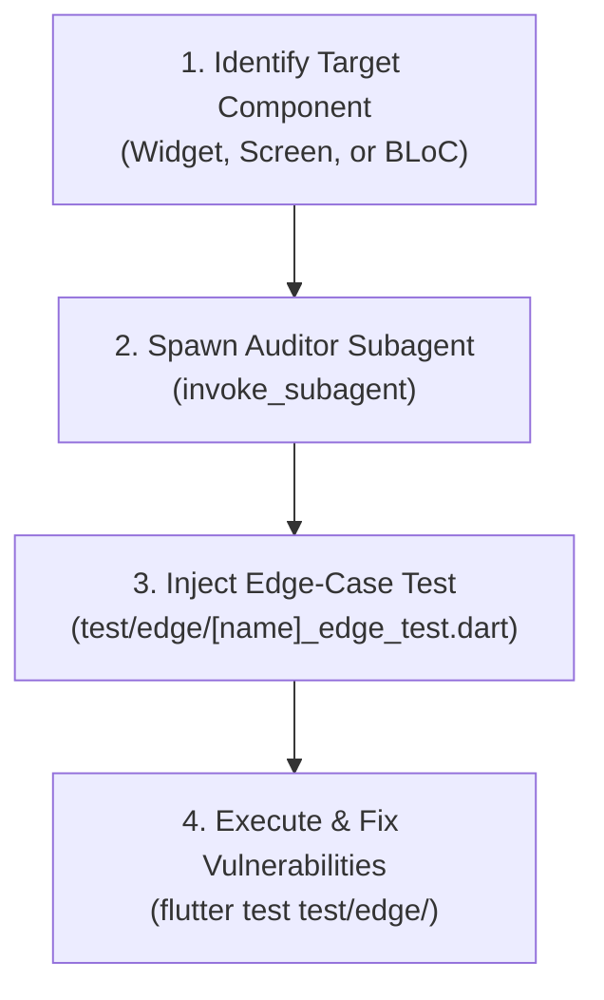

# Flutter Adversarial QA & Edge-Case Testing (`flutter-adversarial-qa`)

Specialized workflow for eliminating author confirmation bias by delegating code review, edge-case analysis, and stress testing to an independent auditor subagent.

---

## Architectural Rules & Standards

### 1. The Unbiased Auditor Principle
- The primary agent who wrote the widget or feature MUST NOT self-certify edge cases.
- You MUST spawn an independent subagent using `invoke_subagent` to audit the code and inject adversarial assertions.

### 2. Adversarial Edge-Case Scope (`test/edge/<widget_name>_edge_test.dart`)
The auditor subagent must verify:
- **Text & Font Stress**: Extremely long strings without spaces, international characters, and 2.0x font scaling without layout overflows.
- **Window Boundary Extremes**: Extremely small window widths/heights to ensure layout does not throw RenderFlex overflows.
- **Double-Tap & Race Conditions**: Rapid button taps and async actions triggering multiple simultaneous requests.
- **Disposal & Lifecycle**: Ensuring controllers and subscriptions are closed when widgets are unmounted mid-flight.

---

## Step-by-Step Execution Checklist



- [ ] **Step 1: Spawn Auditor Subagent**
  - Prompt an independent subagent with the target widget code and relevant state models.
- [ ] **Step 2: Generate Edge-Case Tests**
  - Scaffold tests in `test/edge/<widget_name>_edge_test.dart`.
  - Simulate font scale, boundary sizes, null values, and rapid interactions.
- [ ] **Step 3: Run Adversarial Tests**
  - Run the test suite:
    ```powershell
    flutter test test/edge/<widget_name>_edge_test.dart
    ```
- [ ] **Step 4: Harden Implementation**
  - Fix any exposed layout overflows, uncaught exceptions, or race conditions in the component.

---

## Edge Cases & Known AI Pitfalls

- **Yellow-and-Black Stripes**: `RenderFlex overflowed by X pixels` is the most common Flutter bug. The auditor must test dynamic text lengths and responsive screen resize bounds.
- **Async Gap Context Loss**: Assert that widget code does not use `context` after an `await` without checking `context.mounted`.
- **Memory Leaks**: Detect unclosed `StreamSubscription` or missing `dispose()` calls.

---

## Reference Guides

- [Adversarial Checklist](./references/adversarial-checklist.md)
- [Common Dart & Flutter Pitfalls](./references/dart-pitfalls.md)
