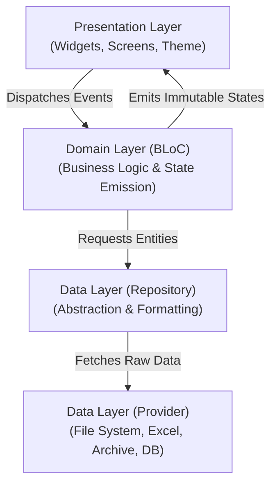

# Flutter Application Architecture (`flutter-app-arch`)

Provides structured, production-grade guidance for architecting Flutter applications using the official [Flutter App Architecture Recommendations](https://docs.flutter.dev/app-architecture/recommendations) and [BLoC Architecture](file:///d:/Scripts/Obsidian/Computer/Front%20end/Flutter/Bloc%20state%20management.md).

---

## Architecture Overview

---

## Workflow Checklist

Execute architectural milestones systematically:

- [ ] **Step 1: Data Layer Scaffolding**
  - Create raw data providers under `lib/src/data/providers/` (e.g. `ExcelProvider`, `ArchiveProvider`).
  - Create domain repositories under `lib/src/data/repositories/` to coordinate multiple data providers.
  - Model entity classes under `lib/src/data/models/` with immutability.
- [ ] **Step 2: Business Logic (BLoC) Implementation**
  - Define explicit user intents as Events (`lib/src/logic/<feature>/<feature>_event.dart`).
  - Define UI snapshots as States (`lib/src/logic/<feature>/<feature>_state.dart`) using `Equatable`.
  - Coordinate logic in BLoC without any UI widget or platform dependencies.
  - Offload heavy operations (Excel parsing, compression) to background isolates via `Isolate.run()`.
- [ ] **Step 3: Presentation & Theme Integration**
  - Scaffold screens under `lib/src/presentation/screens/` and widgets under `lib/src/presentation/widgets/`.
  - Connect widgets via `BlocBuilder` and `BlocConsumer`.
  - Use semantic Material 3 tokens via [app_theme.dart.template](./resources/templates/app_theme.dart.template).

---

## Edge Cases & Known Pitfalls

- **UI Thread Blocking**: Never parse large Excel spreadsheets or compress archives directly on the main UI isolate; wrap file processing with `Isolate.run()`.
- **CardTheme Type Mismatch**: In Flutter 3.x/Material 3, `ThemeData.cardTheme` requires `CardThemeData`, not `CardTheme`.
- **State Mutation**: Never mutate collections inside emitted BLoC states; always emit new instances (`List.unmodifiable` or copies).

---

## Deep References

- [Architecture & BLoC Deep Dive](./references/architecture_guide.md)
- [Theming & Styling Guidelines](./references/theming_guide.md)
- [Theme Template File](./resources/templates/app_theme.dart.template)
