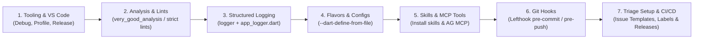

# Flutter Development Setup (`flutter-dev-setup`)

A structured, end-to-end orchestration runbook for discovering, configuring, and verifying the Flutter development environment, analysis options, VS Code launch targets, structured logging, build flavors, Git hooks, GitHub triage infrastructure, official Flutter/Dart skills installation, MCP tool integration, and automated GitHub Actions release automation.

> [!TIP]
> **Official Reference:**
> - [How Flutter AI tools work](https://docs.flutter.dev/ai/tools)

---

## Pre-Conditions & Discovery

- [ ] **Specification Inspection**: Read `docs/project.json` if present to configure target platforms, state management, and localization.
- [ ] **Environment Verification**: Verify Flutter installation and desktop embedding status via `flutter doctor`.
- [ ] **Workspace Scan**: Inspect existing `pubspec.yaml`, analysis options, and `.vscode/` configs before generating files.
- [ ] Consult [vscode-and-tooling.md](./references/vscode-and-tooling.md) for launch target profiles.
- [ ] Consult [logging-and-observability.md](./references/logging-and-observability.md) before instrumenting services or widgets.
- [ ] Consult [ai-tools-and-mcp.md](./references/ai-tools-and-mcp.md) for official skills installation and MCP server configs.

---

## Step-by-Step Execution Checklist



### Stage 1: VS Code Launch Options & IDE Tooling
1. Scaffold `.vscode/launch.json` using [launch.json.template](./resources/templates/launch.json.template) with:
   - **Debug**: Standard JIT debug configuration on target device (e.g. `windows`).
   - **Profile Mode**: High-performance profile mode (`--profile`) to diagnose frame rendering, GPU rasterization, and memory leaks.
   - **Release Mode**: AOT release mode (`--release`) to validate production behavior.
2. Configure `.vscode/settings.json` using [settings.json.template](./resources/templates/settings.json.template) with formatting rules and default target device arguments.

### Stage 2: Code Analysis & Linter Contracts
1. Deploy `analysis_options.yaml` using [analysis_options.yaml.template](./resources/templates/analysis_options.yaml.template).
2. Enforce critical performance and safety rules:
   - `prefer_const_constructors` (reduces widget rebuild garbage collection).
   - `avoid_print` (mandates the structured logger from Stage 3; see also `flutter-observability`).
   - `unawaited_futures` (prevents silent async exception drops).

### Stage 3: Structured Logging & Observability
1. Add the logger dependency:
   ```powershell
   flutter pub add logger
   ```
2. Deploy `lib/core/logging/app_logger.dart` from [app_logger.dart.template](./resources/templates/app_logger.dart.template):
   - Named output: `[Tag] LEVEL message`, plus an optional error and a 6-line stack trace.
   - Environment-aware levels: development = `Level.trace`, release = `Level.info`, `flutter test` = `Level.warning`.
   - Uses `ProductionFilter`, **not** `DevelopmentFilter`: the latter relies on asserts and silently drops every log under `dart run` (CLI tools would appear to log nothing).
3. Instrument every service and long-lived widget with a lazily created named logger:
   ```dart
   static final _log = createLogger('MyService');
   ```
   - `TRACE` = per-item detail (files, rows, loop iterations); `DEBUG` = user actions and state changes; `INFO` = completed operations with counts/durations; `WARN` = recoverable issues; `ERROR` = failures with `error:` and `stackTrace:`.
   - Log operation boundaries instead of every statement, and never log from `build()` or other render paths.
4. Background work: create the logger **inside** the isolate/worker and pass only plain values across isolate boundaries; never send a `Logger`.
5. Verify the wiring:
   - `flutter run` shows `TRACE`/`DEBUG`/`INFO` lines with `[Tag]` prefixes.
   - `dart run tool/<cli>.dart` shows the same formatting (proves `ProductionFilter` is active).
   - `flutter test` contains only intentional `WARN`/`ERROR` lines.
   - Run `scripts/verify-env.ps1 -Repair` to scaffold the dependency/file when missing or to confirm the setup.
6. Consult [logging-and-observability.md](./references/logging-and-observability.md). Pair it with the `flutter-observability` skill when crash reporting, BLoC tracing, or network interceptors are also required.

### Stage 4: Flavors & Environment Configuration
1. Scaffold flavor configuration files using [config.dev.json.template](./resources/templates/config.dev.json.template) under `config/`:
   - `config/dev.json` (Local endpoints, verbose logs, debug banner).
   - `config/prod.json` (Production endpoints, strict telemetry).
2. Set up entry points under `lib/`:
   - `lib/main_dev.dart` reading `config/dev.json`.
   - `lib/main_prod.dart` reading `config/prod.json`.
3. Consult [flavors-and-defines.md](./references/flavors-and-defines.md) for run and build command arguments.

### Stage 5: Installing Official Skills & Configuring MCP Tools
1. **Install Official Skills in Project Repository**:
   - Clone and copy skills from [**`flutter/agent-plugins`**](https://github.com/flutter/agent-plugins) into `.agents/skills/`.
   - Clone and copy skills from [**`dart-lang/skills`**](https://github.com/dart-lang/skills) into `.agents/skills/`.
   - Execute `dart run skills get` to discover and install package skills bundled with `pubspec.yaml` dependencies.
2. **Configure Global Antigravity MCP Servers**:
   - Register the **Dart and Flutter MCP server** (`dart run dart_mcp_server`) in `~/.gemini/antigravity/mcp_config.json` and `~/.gemini/config/mcp_config.json`.
   - Register the **Developer Knowledge MCP server** (`https://developers.google.com/knowledge/mcp`) for live online documentation access.
   - Maintain workspace `mcp.json` for portability across machines.
   - Consult [ai-tools-and-mcp.md](./references/ai-tools-and-mcp.md) for full setup instructions.

### Stage 6: Git Hooks & Commit Linting Gate
1. Add `commitlint_cli` (`flutter pub add --dev commitlint_cli`) and configure `commitlint.yaml`.
2. Deploy `lefthook.yml` with:
   - **Pre-commit**: Runs `dart format --set-exit-if-changed .` and `flutter analyze --fatal-infos`.
   - **Commit-msg**: Runs `dart run commitlint_cli --edit {1}` to enforce Conventional Commits.
   - **Pre-push**: Runs `flutter test`.
3. Set up tracked `.githooks/commit-msg` pointing to `dart run commitlint_cli --edit "$1"` via `git config core.hooksPath .githooks`.
4. Consult [git-hooks-and-lints.md](./references/git-hooks-and-lints.md) for full configuration details.

### Stage 7: GitHub Triage Setup, CI/CD & Automated Semantic Releases (Windows & Android)
1. **GitHub Triage Infrastructure Setup**:
   - Execute [`init_triage_infra.ps1`](./scripts/init_triage_infra.ps1) to scaffold `.github/ISSUE_TEMPLATE/bug_report.yml` (from [bug_report.yml.template](./resources/templates/bug_report.yml.template)) and `.github/ISSUE_TEMPLATE/config.yml` (from [issue_config.yml.template](./resources/templates/issue_config.yml.template)), and register standard GitHub triage labels (`bug`, `agent-triage`, `self-repair`, `verified`) for `github-triage`.
2. Deploy [.github/workflows/release-please.yml](./resources/templates/release-please.yml.template).
3. Configure Release Please manifest files:
   - `release-please-config.json` configured for Dart/Flutter packages.
   - `.release-please-manifest.json` tracking current release versions.
4. Configure Windows MSIX & Inno Setup packaging:
   - Configure `msix` in `dev_dependencies` and `msix_config` in `pubspec.yaml`: format `capabilities` as a comma-separated string (e.g., `capabilities: internetClient`), never a YAML list, and set `install_certificate: false`.
   - Deploy `windows/installer/setup.iss` using [setup.iss.template](./resources/templates/setup.iss.template) to compile a standalone `.exe` installer via Inno Setup (`ISCC.exe "/DMyAppVersion=<version>" windows\installer\setup.iss`) before running `msix:create` so the `.exe` installer does not accidentally bundle the `.msix` file.
5. Verify Android Gradle & Kotlin compatibility for CI (`flutter analyze --suggestions`):
   - Set Gradle wrapper `distributionUrl` to at least `gradle-9.1.0-all.zip` in `android/gradle/wrapper/gradle-wrapper.properties`.
   - Set `com.android.application` (AGP) to `8.11.1`+ and `org.jetbrains.kotlin.android` to `2.2.0`+ in `android/settings.gradle.kts`, and `android.newDsl=false` in `android/gradle.properties`.
6. Configure `concurrency: cancel-in-progress: false` on release jobs to protect ongoing builds on `main`, and deploy both Windows (`.exe` setup installer, `.msix` package, and `.zip` portable archive) and Android (`.apk` + `.aab`) artifacts to the GitHub Release page via `gh release upload --clobber`.
7. Consult [release-please-and-cicd.md](./references/release-please-and-cicd.md) for GitHub triage setup, Windows Inno Setup `.exe`, MSIX, Android APK/AAB, and archive bundling specs.

---

## Edge Cases & Known AI Pitfalls

- **Desktop Embedding**: Always ensure Windows desktop is enabled (`flutter config --enable-windows-desktop`) before running desktop launch configurations.
- **Node.js Independence**: Use `lefthook` for Git hooks instead of Node/Husky to keep pure Dart/Flutter environments dependency-free.
- **`DevelopmentFilter` Drops Logs Under `dart run`**: Its level check sits inside an `assert`, so logs vanish whenever asserts are disabled (plain `dart run`, some release configurations). Use `ProductionFilter` and control verbosity with `appLogLevel`.
- **Logger Inside `build()`**: Never create or call a logger from `build()` or other render paths; it floods output and adds log I/O during layout. Log event handlers, service boundaries, and lifecycle methods instead.
- **Logger Across Isolates**: Do not send a `Logger`, `Directory`, or other native-backed object across an isolate boundary. Create the logger inside the worker closure and pass only plain values (`String`, `bool`, `List<String>`).
- **Sensitive Paths in Logs**: File paths and document names may contain usernames or client data. Keep them at `TRACE`/`DEBUG` where possible, and never log tokens, credentials, or document contents.
- **Standalone Distribution**: Windows desktop builds require all accompanying DLLs and the `data/` folder alongside `<app>.exe`. Never distribute `<app>.exe` in isolation.
- **MSIX `capabilities` Type Error**: In `pubspec.yaml` under `msix_config`, `capabilities` must be a comma-separated string (`capabilities: internetClient`), NOT a YAML list (`- internetClient`), otherwise `msix:create` crashes with `type 'YamlList' is not a subtype of type 'String?'`.
- **Android CI Gradle/Kotlin Version Mismatch**: `subosito/flutter-action@v2` (`channel: stable`) installs the latest Flutter stable release on CI runners, which requires Gradle >= 8.14 and Kotlin >= 2.2.0. Always run `flutter analyze --suggestions` to validate Gradle/AGP/KGP compatibility and set `android.newDsl=false` in `android/gradle.properties`.
- **Release Please PR Permissions**: By default, GitHub blocks `GITHUB_TOKEN` from opening PRs. Enable **Allow GitHub Actions to create and approve pull requests** under repository **Settings > Actions > General > Workflow permissions**, otherwise Release Please fails to create release PRs.
- **MCP Disabling Behavior**: Antigravity ignores `"disabled": true` inside `mcpServers`. Move disabled servers outside `mcpServers` (e.g., to `_disabledMcpServers`).

---

## Reference Guides

- [Flavors & Dart Defines Guide](./references/flavors-and-defines.md)
- [Structured Logging & Observability Guide](./references/logging-and-observability.md)
- [VS Code & Tooling Guide](./references/vscode-and-tooling.md)
- [Git Hooks & Analysis Guide](./references/git-hooks-and-lints.md)
- [AI Tools & MCP Integration Guide](./references/ai-tools-and-mcp.md)
- [Release Please & CI/CD Guide](./references/release-please-and-cicd.md)
- [GitHub Triage Infrastructure Script](./scripts/init_triage_infra.ps1)
- [Environment Verification Script](./scripts/verify-env.ps1)
