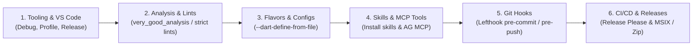

# Flutter Development Setup (`flutter-dev-setup`)

A structured, end-to-end orchestration runbook for discovering, configuring, and verifying the Flutter development environment, analysis options, VS Code launch targets, build flavors, Git hooks, official Flutter/Dart skills installation, MCP tool integration, and automated GitHub Actions release automation.

> [!TIP]
> **Official Reference:**
> - [How Flutter AI tools work](https://docs.flutter.dev/ai/tools)

---

## Pre-Conditions & Discovery

- [ ] **Environment Verification**: Verify Flutter installation and desktop embedding status via `flutter doctor`.
- [ ] **Workspace Scan**: Inspect existing `pubspec.yaml`, analysis options, and `.vscode/` configs before generating files.
- [ ] Consult [vscode-and-tooling.md](./references/vscode-and-tooling.md) for launch target profiles.
- [ ] Consult [ai-tools-and-mcp.md](./references/ai-tools-and-mcp.md) for official skills installation and MCP server configs.

---

## Step-by-Step Execution Checklist

### Stage 1: VS Code Launch Options & IDE Tooling
1. Scaffold `.vscode/launch.json` using [launch.json.template](./resources/templates/launch.json.template) with:
   - **Debug**: Standard JIT debug configuration on target device (e.g. `windows`).
   - **Profile Mode**: High-performance profile mode (`--profile`) to diagnose frame rendering, GPU rasterization, and memory leaks.
   - **Release Mode**: AOT release mode (`--release`) to validate production behavior.
2. Configure `.vscode/settings.json` using [settings.json.template](./resources/templates/settings.json.template) with formatting rules and default target device arguments.

### Stage 2: Code Analysis & Linter Contracts
1. Deploy `analysis_options.yaml` using [analysis_options.yaml.template](./resources/templates/analysis_options.yaml.template).
2. Enforce critical performance and safety rules:
   - `prefer_const_constructors` (reduces widget rebuild garbage collection).
   - `avoid_print` (mandates structured loggers via `flutter-observability`).
   - `unawaited_futures` (prevents silent async exception drops).

### Stage 3: Flavors & Environment Configuration
1. Scaffold flavor configuration files using [config.dev.json.template](./resources/templates/config.dev.json.template) under `config/`:
   - `config/dev.json` (Local endpoints, verbose logs, debug banner).
   - `config/prod.json` (Production endpoints, strict telemetry).
2. Set up entry points under `lib/`:
   - `lib/main_dev.dart` reading `config/dev.json`.
   - `lib/main_prod.dart` reading `config/prod.json`.
3. Consult [flavors-and-defines.md](./references/flavors-and-defines.md) for run and build command arguments.

### Stage 4: Installing Official Skills & Configuring MCP Tools
1. **Install Official Skills in Project Repository**:
   - Clone and copy skills from [**`flutter/agent-plugins`**](https://github.com/flutter/agent-plugins) into `.agents/skills/`.
   - Clone and copy skills from [**`dart-lang/skills`**](https://github.com/dart-lang/skills) into `.agents/skills/`.
   - Execute `dart run skills get` to discover and install package skills bundled with `pubspec.yaml` dependencies.
2. **Configure Global Antigravity MCP Servers**:
   - Register the **Dart and Flutter MCP server** (`dart run dart_mcp_server`) in `~/.gemini/antigravity/mcp_config.json` and `~/.gemini/config/mcp_config.json`.
   - Register the **Developer Knowledge MCP server** (`https://developers.google.com/knowledge/mcp`) for live online documentation access.
   - Maintain workspace `mcp.json` for portability across machines.
   - Consult [ai-tools-and-mcp.md](./references/ai-tools-and-mcp.md) for full setup instructions.

### Stage 5: Git Hooks & Commit Linting Gate
1. Add `commitlint_cli` (`flutter pub add --dev commitlint_cli`) and configure `commitlint.yaml`.
2. Deploy `lefthook.yml` with:
   - **Pre-commit**: Runs `dart format --set-exit-if-changed .` and `flutter analyze --fatal-infos`.
   - **Commit-msg**: Runs `dart run commitlint_cli --edit {1}` to enforce Conventional Commits.
   - **Pre-push**: Runs `flutter test`.
3. Set up tracked `.githooks/commit-msg` pointing to `dart run commitlint_cli --edit "$1"` via `git config core.hooksPath .githooks`.
4. Consult [git-hooks-and-lints.md](./references/git-hooks-and-lints.md) for full configuration details.

### Stage 6: CI/CD & Automated Semantic Releases
1. Deploy [.github/workflows/release-please.yml](./resources/templates/release-please.yml.template).
2. Configure Release Please manifest files:
   - `release-please-config.json` configured for Dart/Flutter packages.
   - `.release-please-manifest.json` tracking current release versions.
3. Configure `concurrency: cancel-in-progress: false` on release jobs to protect ongoing builds on `main`.
4. Consult [release-please-and-cicd.md](./references/release-please-and-cicd.md) for Windows MSIX and archive bundling specs.

---

## Edge Cases & Known AI Pitfalls

- **Desktop Embedding**: Always ensure Windows desktop is enabled (`flutter config --enable-windows-desktop`) before running desktop launch configurations.
- **Node.js Independence**: Use `lefthook` for Git hooks instead of Node/Husky to keep pure Dart/Flutter environments dependency-free.
- **Standalone Distribution**: Windows desktop builds require all accompanying DLLs and the `data/` folder alongside `<app>.exe`. Never distribute `<app>.exe` in isolation.
- **MCP Disabling Behavior**: Antigravity ignores `"disabled": true` inside `mcpServers`. Move disabled servers outside `mcpServers` (e.g., to `_disabledMcpServers`).

---

## Reference Guides

- [Flavors & Dart Defines Guide](./references/flavors-and-defines.md)
- [VS Code & Tooling Guide](./references/vscode-and-tooling.md)
- [Git Hooks & Analysis Guide](./references/git-hooks-and-lints.md)
- [AI Tools & MCP Integration Guide](./references/ai-tools-and-mcp.md)
- [Release Please & CI/CD Guide](./references/release-please-and-cicd.md)
- [Environment Verification Script](./scripts/verify-env.ps1)
