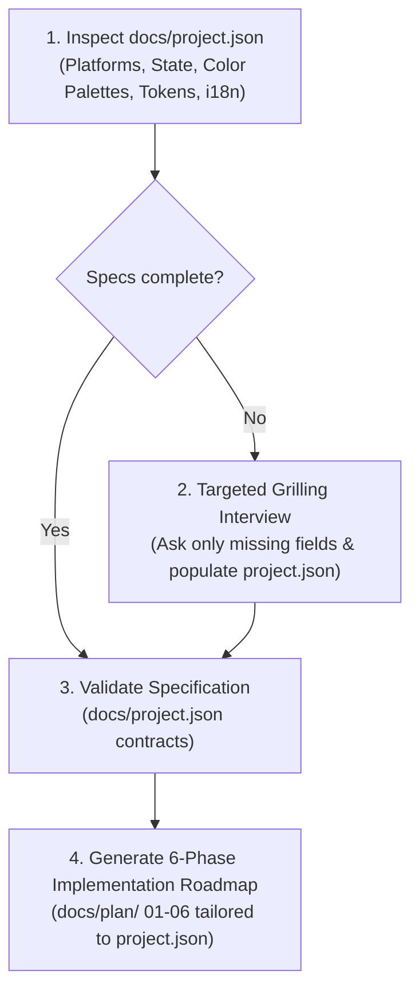

# Flutter Application Planning (`flutter-plan`)

A specification-driven planning skill for Flutter applications. It uses `docs/project.json` as the single source of truth—capturing target platforms, state management library, theme color palettes and semantic tokens, and localization requirements—to generate an adaptive 6-phase implementation roadmap in `docs/plan/`.

---

## Workflow Overview

---

## Execution Stages

### Stage 1: Inspect & Initialize `docs/project.json`

1. Read [docs/project.json](file:///d:/Scripts/FtFileSorter/docs/project.json).
2. If `docs/project.json` does not exist or has missing sections:
   - Run the targeted questions in [interview-rounds.md](./references/interview-rounds.md), skipping any section already specified.
   - Scaffold or update `docs/project.json` using [project.template.json](./resources/templates/project.template.json) and [project-json-schema.md](./references/project-json-schema.md).
3. The specification must explicitly capture:
   - **`platforms`**: Target operating systems (e.g., `["windows"]`, `["android", "ios"]`) and desktop window settings.
   - **`state_management`**: State library (`bloc`, `cubit`, `riverpod`) and architecture patterns.
   - **`theming`**: Design system (`material_3`, `fluent_ui`), `color_palettes` (hex contracts for Light and Dark modes), and `semantic_tokens` for Flutter `ThemeExtension`.
   - **`i18n`**: Default locale, supported locales list, RTL support flag, and ARB paths.
   - **`di_container`** & **`networking`**: Dependency injection and HTTP/data backend choices.

### Stage 2: Scaffolding the 6-Phase Roadmap Specific to `project.json`

Generate roadmap markdown files under `docs/plan/`, directly consuming values from `docs/project.json`:

1. `01-environment-and-tooling.md`: Dependencies matching `project.json.platforms`, state library, and networking client; analysis options and build flavors.
2. `02-architecture-and-di.md`: Dependency injection container (`project.json.di_container`), repository contracts, and network client initialization.
3. `03-core-foundations.md`: Exact Light/Dark `ColorScheme` values from `project.json.theming.color_palettes`, `ThemeExtension` class for `project.json.theming.semantic_tokens`, ARB catalogs for all `project.json.i18n.supported_locales`, RTL layout handling, and `go_router`.
4. `04-data-and-domain-layer.md`: Data providers, local databases (`project.json.storage`), domain entities, and state units (`project.json.state_management.library`).
5. `05-presentation-and-widgets.md`: Feature screens checklist with theme token consumption, localized ARB strings, state listeners/builders, and platform-responsive layouts.
6. `06-packaging-and-release.md`: Platform packaging pipelines matching `project.json.platforms` (e.g. Windows MSIX/Inno Setup, Android AAB, CI/CD GitHub Actions).

Consult [roadmap-structure.md](./references/roadmap-structure.md) for detailed phase generation templates.

---

## Edge Cases & Architectural Pitfalls

- **Desktop vs Mobile UX**: Ensure desktop targets in `project.json.platforms` include desktop ergonomics (multi-pane, sidebars, keyboard shortcuts) instead of stretched mobile layouts.
- **Async Thread Safety**: Heavy file operations or large JSON decodes must be scheduled in background isolates via `Isolate.run()`.
- **Hardcoded Strings**: Never plan placeholder UI without requiring ARB dictionary keys for every locale in `project.json.i18n.supported_locales`.
- **Theme Token Drift**: Always bind UI colors to `Theme.of(context).colorScheme` or `Theme.of(context).extension<AppThemeExtension>()` rather than hardcoded hex values.

---

## Reference Guides

- [Project JSON Specification Schema](./references/project-json-schema.md)
- [Targeted Interview Questions](./references/interview-rounds.md)
- [6-Phase Roadmap Guidelines](./references/roadmap-structure.md)
- [Canonical Project Template](./resources/templates/project.template.json)
