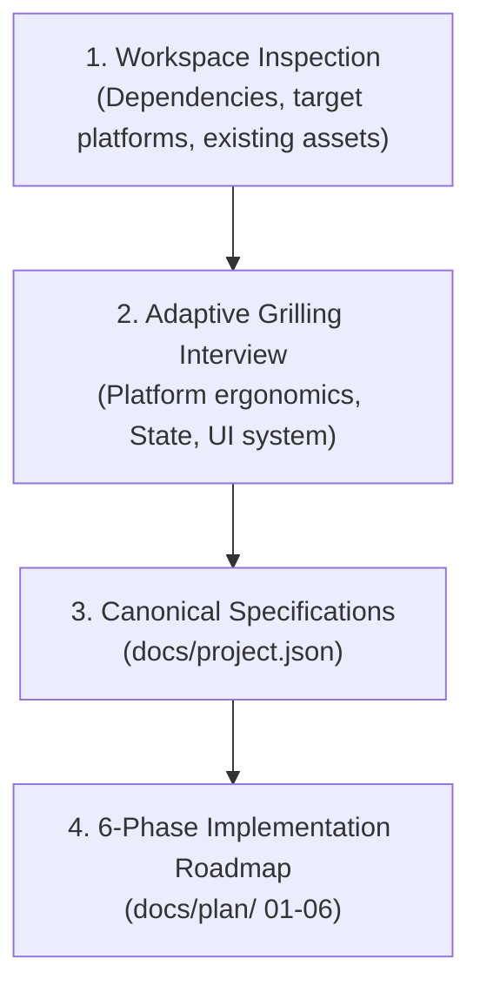

# Flutter Application Planning (`flutter-plan`)

A structured orchestration skill for planning Flutter applications. It conducts a multi-round grilling interview on target platforms, ergonomics, state management, and data flow, outputting canonical specifications (`docs/project.json`) and a 6-phase implementation roadmap in `docs/plan/`.

---

## Workflow Overview

---

## Phase 0: Multi-Round Grilling Interview

Conduct the interview in **progressive, adaptive rounds**, waiting for user responses after each round:

### Round 1: Target Platforms & System Ergonomics
- Target platforms (Windows Desktop, macOS, Linux, Android, iOS, Web).
- For Desktop: Window size/position persistence (`window_manager`), file system/local database needs (`sqlite3`, `path_provider`), system tray, or native dialogs.

### Round 2: Architecture & Data Flow
- State management preference: BLoC / Cubit (standard) vs Riverpod.
- Offline-first caching strategy: Local SQLite vs Hive vs Secure Storage.
- API protocol: REST (`dio`), GraphQL, or WebSocket streams.

### Round 3: Design Tokens & Localization
- Design language: Material 3 vs `fluent_ui` (Windows 11 Native).
- Theme mode: Light, Dark, or System with semantic tokens.
- Localization: Target languages, RTL (Persian/Arabic) requirements, and ARB catalogs.

Consult [interview-rounds.md](./references/interview-rounds.md) for complete question trees.

---

## Step-by-Step Execution Flow

### Stage 1: Generate Canonical Specification (`docs/project.json`)
Initialize `docs/project.json` using [project.template.json](./resources/templates/project.template.json) capturing:
- Target platforms and form factors.
- State management and dependency injection rules.
- Supported locales and default fallback.
- Design token contracts.

### Stage 2: Scaffolding the 6-Phase Implementation Roadmap
Generate roadmap files under `docs/plan/`:
1. `01-environment-and-tooling.md`: Flavors, analysis, launch configs.
2. `02-architecture-and-di.md`: Dependency injection (`get_it`), base API client, error handling contracts.
3. `03-core-foundations.md`: Theme tokens, localization catalogs (`.arb`), routing (`go_router`).
4. `04-data-and-domain-layer.md`: Data providers, repositories, BLoCs, background isolates.
5. `05-presentation-and-widgets.md`: Feature checklists (Screen, BLoC, Loading/Skeleton state, Error recovery, Widget tests).
6. `06-packaging-and-release.md`: App icons, Windows installer/MSIX, automated CI/CD release workflow.

Consult [roadmap-structure.md](./references/roadmap-structure.md) for section templates.

---

## Edge Cases & Known AI Pitfalls

- **Desktop vs Mobile UX**: Never design a desktop app as a stretched mobile phone interface. Account for multi-column layouts, sidebars, and keyboard shortcuts.
- **Async Thread Safety**: Heavy file operations or JSON decodes must be scheduled in background isolates via `Isolate.run()` to prevent frame drops.
- **Hardcoded Strings**: Never plan placeholder UI without requiring ARB dictionary keys.

---

## Reference Guides

- [Interview Rounds & Probing Questions](./references/interview-rounds.md)
- [Project JSON Specification Schema](./references/project-json-schema.md)
- [6-Phase Roadmap Guidelines](./references/roadmap-structure.md)
