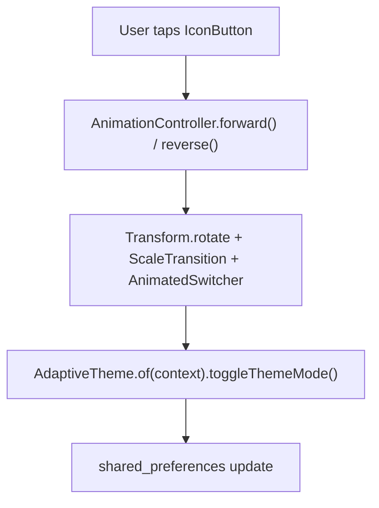

# Sun-to-Moon Animated Toggle Guide

This reference details the design and implementation of the animated Sun <-> Moon theme switch button.

## Visual Transition Specs

- **Duration**: 450ms–500ms for smooth perception.
- **Curve**: `Curves.easeInOutCubic` or `Curves.easeInOutBack` for subtle organic spring.
- **Rotation**: 180° (0.5 turns) counter-clockwise on dark transition, clockwise on light transition.
- **Scale**: Dips slightly (0.8x) midway to accentuate transition depth.
- **Color Morphing**:
  - Light mode (Sun): Amber/Golden orange (`#F59E0B` / `Colors.amber.shade700`).
  - Dark mode (Moon): Soft Indigo/Cyan (`#818CF8` / `Colors.indigo.shade200`).

## Architecture Pattern

The animated switch should support both `AdaptiveTheme` and standard Flutter `ThemeMode`:

## Key Widget Implementation Elements

1. **`AnimatedBuilder` / `AnimatedSwitcher`**: Renders Sun (`Icons.light_mode_rounded`) or Moon (`Icons.dark_mode_rounded`) icon with rotational physics.
2. **Haptic Feedback**: Invoke `HapticFeedback.selectionClick()` on tap for tactile responsiveness.
3. **Accessibility**: Wrap with `Semantics(label: isDark ? 'Switch to light theme' : 'Switch to dark theme', button: true)` and localized tooltip.
