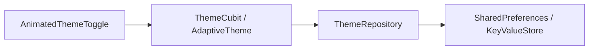

# Theme Repository & Persistence Guide

## Overview

Theme preference must persist across app reboots. We support two approaches:
1. **Clean Architecture Theme Repository (`IThemeRepository`)**: Native BLoC/Cubit pattern utilizing `shared_preferences`.
2. **`adaptive_theme` Package Integration**: Rapid drop-in provider managing root rebuilds and system brightness listeners.

## Architecture Contract



## Approach A: Native Clean Architecture Repository

### Abstract Interface
```dart
abstract interface class IThemeRepository {
  Future<ThemeMode> getThemeMode();
  Future<void> saveThemeMode(ThemeMode mode);
}
```

### SharedPreferences Implementation
```dart
class ThemeRepository implements IThemeRepository {
  static const _themeKey = 'app_theme_mode';
  final SharedPreferences _prefs;

  ThemeRepository(this._prefs);

  @override
  Future<ThemeMode> getThemeMode() async {
    final value = _prefs.getString(_themeKey);
    return switch (value) {
      'light' => ThemeMode.light,
      'dark' => ThemeMode.dark,
      _ => ThemeMode.system,
    };
  }

  @override
  Future<void> saveThemeMode(ThemeMode mode) async {
    await _prefs.setString(_themeKey, mode.name);
  }
}
```

## Approach B: `adaptive_theme` Package

When `adaptive_theme` is used (`adaptive_theme: ^3.8.0`):

```dart
void main() async {
  WidgetsFlutterBinding.ensureInitialized();
  final savedThemeMode = await AdaptiveTheme.getThemeMode();
  runApp(MyApp(savedThemeMode: savedThemeMode));
}

class MyApp extends StatelessWidget {
  final AdaptiveThemeMode? savedThemeMode;
  const MyApp({super.key, this.savedThemeMode});

  @override
  Widget build(BuildContext context) {
    return AdaptiveTheme(
      light: AppTheme.lightTheme,
      dark: AppTheme.darkTheme,
      initial: savedThemeMode ?? AdaptiveThemeMode.system,
      builder: (theme, darkTheme) => MaterialApp(
        theme: theme,
        darkTheme: darkTheme,
        home: const HomeScreen(),
      ),
    );
  }
}
```
Toggle with `AdaptiveTheme.of(context).toggleThemeMode()`.
