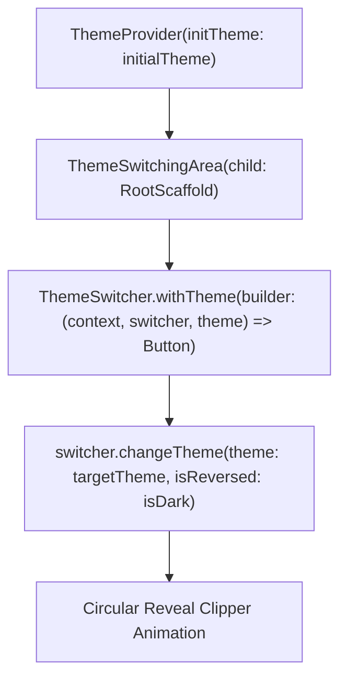

# Circular Reveal Theme Transition Guide

This reference details implementing GPU-accelerated circular reveal transitions using [`animated_theme_switcher`](https://pub.dev/packages/animated_theme_switcher).

## Architecture

The circular reveal pattern captures screen coordinates from the tap event and animates a circular clipping shader across the screen, avoiding the stutter associated with manual ticker rebuilds.

## Setup Rules & Caveats

1. **Root Wrapping**:
   - Wrap `MaterialApp` with `ThemeProvider(initTheme: ..., builder: (context, theme) => MaterialApp(theme: theme, ...))`.
   - Do NOT declare conflicting `darkTheme` or `themeMode` on `MaterialApp` that could override the injected `theme`.

2. **Screen Capture Boundary (`ThemeSwitchingArea`)**:
   - Wrap your main root page (e.g. `ConfigurationScreen` or `Scaffold`) in `ThemeSwitchingArea` so the shader knows which viewport region to capture and clip.
   - For sub-screens pushed via `Navigator.push`, wrap them with `ThemeSwitchingArea` or inherit from the parent route.

3. **Reverse Direction**:
   - Pass `isReversed: isDark` to `switcher.changeTheme(...)` so transitioning to dark expands outward and transitioning back smoothly collapses or reverses from the tap origin.
