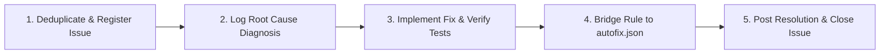

# GitHub Triage (`github-triage`)

An automated GitHub issue tracking and bug triage engine that deduplicates and registers bug issues, logs diagnostic investigations, gates closure on automated test verification, and bridges preventative rules into `.agents/autofix.json`.

---

## Prerequisites & Preconditions

- [ ] Working workspace repository with a configured Git remote (`git remote -v`).
- [ ] GitHub triage infrastructure (`.github/ISSUE_TEMPLATE/bug_report.yml`, `.github/ISSUE_TEMPLATE/config.yml`, and labels `bug`, `agent-triage`, `self-repair`, `verified`) initialized via the project setup skill (`nextjs-dev-setup`, `flutter-dev-setup`, or `setup-repository`).
- [ ] Either `github-mcp-server` MCP tools or GitHub CLI (`gh`) available in PATH.
- [ ] Active project test suite (e.g., Jest, Playwright, `flutter test`, or verification scripts).

---

## Operational Triage Runbook



### Stage 1: Deduplication & Issue Registration
- [ ] Search existing open repository issues for keywords matching the bug.
  - Review tool invocation examples in [github-mcp-and-cli.md](./references/github-mcp-and-cli.md) or run [`triage_issue.ps1`](./scripts/triage_issue.ps1) with `-Action search`.
- [ ] **If matching open issue exists:** Note Issue `#N` and append a status comment.
- [ ] **If new issue:** Create issue using title format `fix(<scope>): <short description>` and labels `["bug", "agent-triage"]`. Save returned Issue `#N`.

### Stage 2: Root Cause Investigation & Diagnostic Logging
- [ ] Analyze the failure origin, reproduction conditions, and affected files.
- [ ] Post a diagnostic comment on Issue `#N` utilizing the [diagnostic_comment.md](./resources/templates/diagnostic_comment.md) template.
- [ ] Consult [triage-lifecycle.md](./references/triage-lifecycle.md) for state transitions and diagnostic requirements.

### Stage 3: Implementation & Verification Gate
- [ ] Apply code edits to resolve the bug in the workspace.
- [ ] Author or update automated regression tests (unit, widget, or E2E spec).
- [ ] Execute verification commands (e.g., `pnpm test`, `flutter test`, or verification scripts).
- [ ] **CRITICAL:** Do NOT proceed to close the issue if tests or verification checks fail.

### Stage 4: Self-Repair Memory Bridge (`autofix.json`)
- [ ] Extract an imperative constraint preventing this failure class from recurring.
- [ ] Append the rule to `.agents/autofix.json` following the schema in [self-repair-bridge.md](./references/self-repair-bridge.md):
  - Incremented `Rule_number`
  - Valid `Category` (`[CODE]`, `[ARCH]`, `[STYLE]`, `[TOOL]`, `[PROCESS]`, `[DATA]`, `[UX]`, `[OTHER]`)
  - Clear imperative `Instruction` and `Why`
  - Audit link: `"Issue": "#N"`

### Stage 5: Resolution Summary & Closure
- [ ] Post a final comment on Issue `#N` using [resolution_comment.md](./resources/templates/resolution_comment.md) summarizing changes, test passes, and the new autofix rule.
- [ ] Close Issue `#N` with `state: "closed"` and `state_reason: "completed"`.

---

## Edge Cases & Known AI Pitfalls

- **Duplicate Spawns**: Always search existing open issues before calling `issue_write` or `gh issue create` to avoid duplicate bug tickets.
- **Premature Closure**: Never close an issue before the test suite passes. If tests fail, iterate on the fix.
- **Unauthenticated Fallback**: When `gh` is unauthenticated and MCP is unavailable, `triage_issue.ps1` automatically resolves `GH_TOKEN` from Git Credential Manager; if still unauthenticated, log the triage report locally and warn the user.
- **Vague autofix Rules**: Ensure the rule in `autofix.json` specifies concrete imperative instructions (`"Never X; always Y"`), not vague advice.

---

## Output Contract

Upon completing a triage cycle, report the resolution to the user:

```markdown
### 🎯 GitHub Triage Summary
- **Issue:** [#24: fix(cart): hydration mismatch](https://github.com/...)
- **Status:** Closed as completed
- **Root Cause:** Synchronous localStorage access in initial render
- **Verification:** Unit tests passed (`pnpm test:unit`)
- **Self-Repair:** Rule #12 added to `.agents/autofix.json`
```
