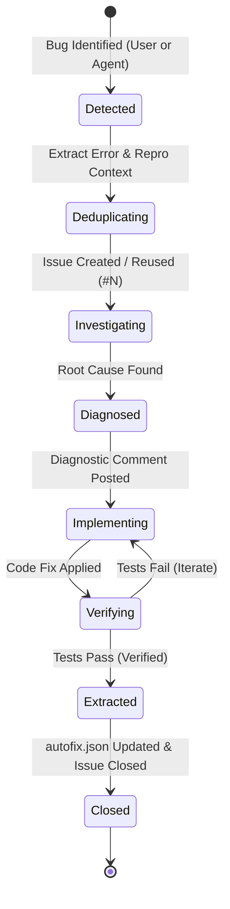

# GitHub Triage Lifecycle & State Machine

This document details the operational state machine and transition rules for triaging bugs, logging fixes, and maintaining historical traceability.

---

## 1. State Diagram

---

## 2. State Transition Rules

### State 1: `Detected`
- **Trigger**:
  1. *Autonomous*: An automated test fails, or an unhandled exception/syntax error occurs during development.
  2. *User-Directed*: The user reports an error, unexpected UI behavior, or broken feature.
- **Action**: Extract error message, stack trace, and reproduction criteria.

### State 2: `Deduplicating`
- **Action**: Search open repository issues using keywords.
  - If a matching open issue exists: record existing Issue `#N` and append a status comment.
  - If no match exists: open a new issue with labels `bug` and `agent-triage`. Record new Issue `#N`.

### State 3: `Investigating & Diagnosed`
- **Action**: Read relevant source files, analyze trace paths, and pinpoint the exact bug origin.
- **Output**: Post a diagnostic comment on Issue `#N` using the diagnostic template.

### State 4: `Implementing & Verifying`
- **Action**: Modify code files and author a regression unit or E2E test.
- **Verification Gate**: Execute the project's test command (e.g. `pnpm test`, `flutter test`, or `verify-dev.ps1`). The issue MUST NOT be closed if verification fails.

### State 5: `Extracted & Closed`
- **Action**:
  1. Formulate a preventative rule and append it to `.agents/autofix.json` with `"Issue": "#N"`.
  2. Post a final resolution comment summarizing fixes, verification results, and the new autofix rule.
  3. Close Issue `#N` with state `closed` and reason `completed`.
