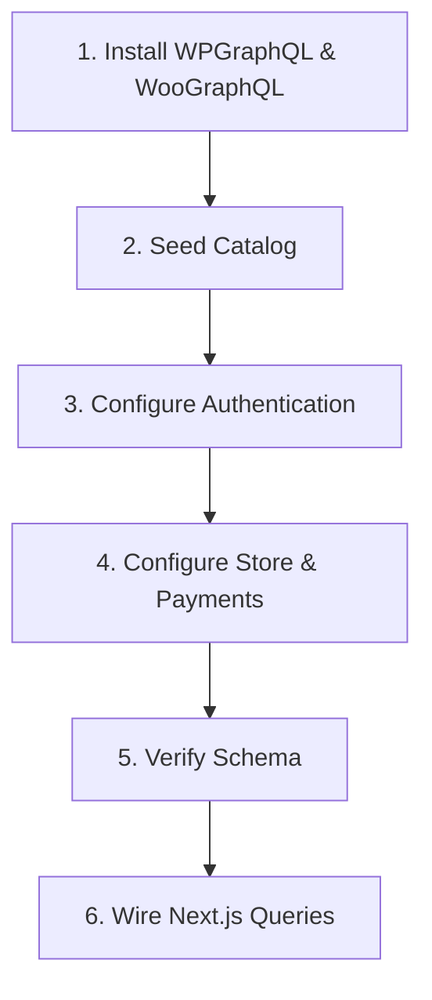

# Headless WooCommerce API (`headless-woocommerce-api`)

Backend runbook for standing up WordPress + WooCommerce, exposing it through WPGraphQL/WooGraphQL, securing it with JWT, and querying it from a decoupled storefront.

---

## Prerequisites & References

- [ ] WordPress installed with WooCommerce, **WPGraphQL**, **WooGraphQL**, and **wp-graphql-jwt-authentication**.
- [ ] Docker + WP-CLI available (WP-CLI is not bundled in the official image).
- [ ] [headless-api-reference.md](./references/headless-api-reference.md) — schema and query patterns.
- [ ] [wordpress-bootstrap-and-plugins.md](./references/wordpress-bootstrap-and-plugins.md) — WP-CLI bootstrap, plugin order, version matrix.
- [ ] [store-configuration-iran.md](./references/store-configuration-iran.md) — IRT, Persian WooCommerce, ZarinPal/Zibal, shipping, seeding.
- [ ] [docker-container-operations.md](./references/docker-container-operations.md) — volumes, patches, logs, container recreation.
- [ ] Examples: [patch-wordpress.ps1](./examples/patch-wordpress.ps1), [wp-configure.php](./examples/wp-configure.php), [wp-seed-products.php](./examples/wp-seed-products.php), [storefront-client.ts](./examples/storefront-client.ts).

### Known-Good Stack (verified 2026-10-27)

| Component | Version |
| :--- | :--- |
| WordPress | 6.x (official `wordpress:latest`, PHP 8.3) |
| WooCommerce | 11.2.1 |
| WPGraphQL | 2.25.0 |
| WooGraphQL (`wp-graphql-woocommerce`) | 1.0.3 |
| WPGraphQL JWT Authentication | 0.7.x |
| Persian WooCommerce (`persian-woocommerce`) | 10.0.7 |
| ZarinPal for WooCommerce (`zarinpal-woocommerce-payment-gateway`) | 5.1.1 |

Re-verify compatibility before pinning these versions in a new project.

---

## Step-by-Step Execution Checklist



### Stage 1: Backend Plugin Deployment

- [ ] **WP-CLI**: download the phar on the host and copy it into the container (container `curl` may fail behind a proxy):
  ```powershell
  curl.exe -L -o $env:TEMP\wp-cli.phar https://raw.githubusercontent.com/wp-cli/builds/gh-pages/phar/wp-cli.phar
  docker cp $env:TEMP\wp-cli.phar wordpress:/usr/local/bin/wp
  docker exec wordpress chmod +x /usr/local/bin/wp
  ```
- [ ] **Core install** (fresh named volume):
  ```powershell
  docker exec -u www-data wordpress wp core install --url=https://shop.local --title="Headless Store" --admin_user=admin --admin_password="<password>" --admin_email=admin@shop.local --skip-email --path=/var/www/html
  docker exec -u www-data wordpress wp rewrite structure "/%postname%/" --hard --path=/var/www/html
  ```
- [ ] **Install in order** (WooCommerce first):
  ```powershell
  docker exec -u www-data wordpress wp plugin install woocommerce --activate --path=/var/www/html
  docker exec -u www-data wordpress wp plugin install wp-graphql --activate --path=/var/www/html
  ```
- [ ] **WooGraphQL and JWT** are GitHub releases, not WP.org packages:
  ```powershell
  curl.exe -L -o $env:TEMP\wpgql-woo.zip https://github.com/wp-graphql/wp-graphql-woocommerce/releases/latest/download/wp-graphql-woocommerce.zip
  docker cp $env:TEMP\wpgql-woo.zip wordpress:/tmp/wpgql-woo.zip
  docker exec -u www-data wordpress wp plugin install /tmp/wpgql-woo.zip --activate --path=/var/www/html
  ```
  Repeat for `wp-graphql-jwt-authentication.zip`.
- [ ] **Persian stack** (optional): install `persian-woocommerce` *after* patching `pdo_mysql`; see [store-configuration-iran.md](./references/store-configuration-iran.md).
- [ ] **Rewrite flush**: `wp rewrite flush --hard`, then confirm `/graphql` returns 200.

### Stage 2: Configure Authentication

- [ ] **JWT secret** — the official image does not auto-define arbitrary env vars. Add it through `WORDPRESS_CONFIG_EXTRA` (evaluated at runtime by `wp-config-docker.php`):
  ```yaml
  WORDPRESS_CONFIG_EXTRA: >-
    define('GRAPHQL_JWT_AUTH_SECRET_KEY', '${GRAPHQL_JWT_AUTH_SECRET_KEY}');
  ```
  Generate a 64-character secret without `$`, quotes, or backslashes (it is embedded in a PHP single-quoted string).
- [ ] **Local lifetime** (optional): default access tokens last 300 seconds. Extend only in local:
  ```php
  add_filter('graphql_jwt_auth_expire', function ($expiration) {
      if (function_exists('wp_get_environment_type') && wp_get_environment_type() === 'local') {
          return DAY_IN_SECONDS; // seconds, never an absolute timestamp
      }
      return $expiration;
  });
  ```
- [ ] **Registration settings**: `users_can_register=1`, `default_role=customer`, `woocommerce_registration_generate_password=no`, `woocommerce_registration_generate_username=no`.
- [ ] **Do not rely on the registration payload** for `databaseId`/`email`/`displayName`; they can be null in WooGraphQL even when the customer is created. Re-query after login.

### Stage 3: Store Configuration & Seeding

- [ ] **Currency**: `IRT` (Toman) is only available after Persian WooCommerce is active. Configure after activation:
  ```powershell
  docker exec -u www-data wordpress wp option update woocommerce_currency IRT --path=/var/www/html
  docker exec -u www-data wordpress wp option update woocommerce_default_country IR:THR --path=/var/www/html
  ```
- [ ] **Payment gateways**:
  - COD: `wp wc payment_gateway update cod --enabled=true --user=1`.
  - Persian WooCommerce bundles **Zibal**, not ZarinPal. Install `zarinpal-woocommerce-payment-gateway` separately; its gateway id is `WC_ZPal` and sandbox is `woocommerce_WC_ZPal_settings['sandbox']='yes'`.
  - **ZarinPal sandbox needs no merchant contract**: set `sandbox='yes'` and put a generated UUID (`wp_generate_uuid4()`, or a literal `00000000-0000-0000-0000-000000000000`) in `merchantcode`. The sandbox endpoint does not validate it, so checkout, `order-pay`, and `?wc-api=WC_ZPal` return flows are all verifiable locally.
  - Persist defaults with `wp wc payment_gateway update <id> --enabled=true --user=1` before patching settings; `wp option patch update` fails when the option does not exist yet.
- [ ] **Shipping**: `wp wc shipping_zone update` does not accept `--locations`. Use PHP `WC_Shipping_Zone::set_locations()` + `add_shipping_method('flat_rate')`; see the store configuration reference.
- [ ] **Seed products** from temporary files outside the repository (avoid committing sample data):
  - Categories + simple products + one variable product with local attributes.
  - Set variation attributes (`['size' => 'S']`) and call `WC_Product_Variable::sync($parent_id)`.
  - Verify with a GraphQL query using `... on VariableProduct { variations { nodes { databaseId } } }`.

### Stage 4: Querying Storefront Data

- [ ] **Public catalog** uses inline fragments; `price`, `stockStatus`, and `variations` do not exist on the base `Product`:
  ```graphql
  products(first: 10) {
    nodes {
      __typename
      databaseId
      name
      ... on SimpleProduct { price stockStatus }
      ... on VariableProduct { price stockStatus variations { nodes { databaseId name price } } }
    }
  }
  ```
- [ ] **Prices contain HTML entities** (`&nbsp;`) and the currency symbol; decode before display.
- [ ] **Customer session**: capture the `Woocommerce-Session` response header on `addToCart` and resend it as `woocommerce-session: Session <token>`.
- [ ] **Protected profile**: send `Authorization: Bearer <token>` and `X-JWT-Auth: <token>`; query `viewer` + `customer`.

### Stage 5: Frontend Integration

- [ ] **Native checkout bridge**: `/checkout/?fill_cart=productId:qty:variationId`, handled in `mu-plugins/headless-redirects.php` on `template_redirect` priority `1`.
- [ ] **Classic checkout AJAX**: filter `woocommerce_ajax_get_endpoint` to `/checkout/?wc-ajax=<endpoint>` so AJAX does not hit the Next.js root route.
- [ ] **Block checkout**: verify the cart through `/wp-json/wc/store/v1/cart` with the browser cookie jar; the block renders client-side.
- [ ] **Gateway callbacks**: filter `woocommerce_api_request_url` to `/checkout/?wc-api=<Gateway>`; let Next.js middleware own `/wc-api` (do not route it to WordPress).
- [ ] **CORS (decoupled origins)**: expose `Authorization`, `Content-Type`, `X-JWT-Auth`, `X-JWT-Refresh`, and `woocommerce-session`; allow the storefront origin.

---

## Edge Cases & Known Pitfalls

1. **Unions** — always use `... on SimpleProduct` / `... on VariableProduct`.
2. **Missing session header** — cart items vanish on the next request.
3. **Legacy Gutenberg admin bundles** — prefer constant-driven auth plugins on strict core setups.
4. **CORS** — expose `woocommerce-session` or the browser cannot read it.
5. **Windows Docker I/O** — named volumes for core/MySQL; bind only `mu-plugins`/`uploads.ini`.
6. **Missing `pdo_mysql`** — Persian WooCommerce/Laravel plugins throw `could not find driver` and HTTP 500 on `/wp-admin`; patch after every container creation.
7. **`wc-api` vs `fill_cart`** — variable products fail with `?add-to-cart=`; use `fill_cart` and variation ids.
8. **Container recreation** — `pdo_mysql` and WP-CLI live in the container layer and are lost. Re-run `patch-wordpress.ps1`.
9. **JWT filter units** — `graphql_jwt_auth_expire` takes seconds; a timestamp produces a multi-decade token.
10. **Registration nulls** — re-query the customer after sign-up.
11. **Price entities** — `price` is display-formatted HTML, not a number.
12. **Zibal ≠ ZarinPal** — Persian WooCommerce bundles Zibal; ZarinPal requires its own plugin. Its sandbox accepts a random UUID as `merchantcode`, so no real merchant code is needed to activate it locally.
13. **WP-CLI permissions** — run as `www-data`; root-owned files break plugin updates. The cache-directory warning is harmless.
14. **Apache logs** — `/var/log/apache2/error.log` is stderr; use `docker logs`.
15. **Block checkout** — empty cart redirects `/checkout/` to `/cart/`; populate first.

---

## Verification & Self-Check

- [ ] `/graphql` responds 200 and the schema contains `Product`, `SimpleProduct`, `VariableProduct`, `Cart`, and `Customer`.
- [ ] `productCategories` and `products` return nodes; variable products expose variations.
- [ ] `registerCustomer` creates a user with the `customer` role.
- [ ] `login` returns `authToken` and `customer.sessionToken`.
- [ ] `addToCart` returns the `Woocommerce-Session` header; a follow-up cart query retains the item.
- [ ] `viewer` and `customer` resolve billing and orders for the token.
- [ ] `/wp-admin/` returns 200 after login (no `could not find driver`).
- [ ] Full commands: [headless-api-reference.md](./references/headless-api-reference.md) and the Next.js [verification playbook](../nextjs-woocommerce/references/verification-playbook.md).
