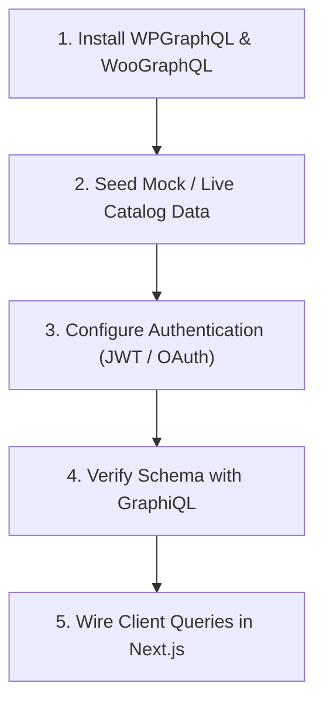

# Headless WooCommerce API (`headless-woocommerce-api`)

Orchestration guide for configuring, querying, and securing WooCommerce backend APIs (WPGraphQL and REST) to power decoupled frontend applications (Next.js, Remix, mobile).

---

## Prerequisites & Preconditions

- [ ] WordPress installed with active **WooCommerce** plugin.
- [ ] Accessible GraphQL endpoint (default: `https://your-store.com/graphql`).
- [ ] For deep queries and technical examples, review [headless-api-reference.md](./references/headless-api-reference.md).
- [ ] For frontend client setup, inspect [storefront-client.ts](./examples/storefront-client.ts).

---

## Step-by-Step Execution Checklist



### Stage 1: Backend Plugin Deployment
- [ ] **Install WPGraphQL Core**:
  - Install and activate `wp-graphql` from WordPress plugin directory.
  - Verify endpoint is live: `GET/POST /graphql`.
- [ ] **Install WooGraphQL Extension**:
  - Download and install [wp-graphql-woocommerce](https://github.com/wp-graphql/wp-graphql-woocommerce).
  - Validates that types (`Product`, `ProductCategory`, `Cart`, `Customer`) appear in GraphQL schema.
- [ ] **Seed Test Data**:
  - Run CSV importer via `Tools → Import → WooCommerce products (CSV)` using `sample-data/sample_products.csv`.

### Stage 2: Configure Headless Authentication
- [ ] **Option A: JWT Auth (`wp-graphql-jwt-authentication`)**:
  - Upload and activate `wp-graphql-jwt-authentication`.
  - Generate a 64-character secret (`openssl rand -base64 48 | tr -dc 'A-Za-z0-9_#%+=@!' | head -c 64` or PowerShell equivalent).
  - Inject to container (`docker exec -it <container> sed -i ... /var/www/html/wp-config.php`), add to `.env` (`GRAPHQL_JWT_AUTH_SECRET_KEY`), or add directly to `wp-config.php`:
    ```php
    define( 'GRAPHQL_JWT_AUTH_SECRET_KEY', 'your-strong-random-secret' );
    ```
- [ ] **Option B: Headless Login (`wp-graphql-headless-login`)**:
  - Use if external OAuth 2.0 / Social login (Google, GitHub) is required.
  - Configure providers via filter or admin settings.

### Stage 3: Querying Storefront Data
- [ ] **Public Catalog**: Query categories and products using union fragments (`... on SimpleProduct`, `... on VariableProduct`).
- [ ] **Customer Session**: Capture `woocommerce-session` header on cart mutations and pass it in subsequent requests.
- [ ] **Protected Profile**: Pass `Authorization: Bearer <authToken>` for customer orders and address updates.

### Stage 4: Frontend Integration (Next.js)
- [ ] Implement SSG/ISR for static product pages using public GraphQL queries.
- [ ] Maintain cart tokens in client-side state (Zustand / LocalStorage) to keep Next.js pages cacheable.
- [ ] Implement Native Checkout Bridge: redirect to WordPress `/checkout` to utilize local payment gateways and e-Namad compliance.

---

## Edge Cases & Known AI Pitfalls

1. **Unions in Product Queries**: WooCommerce products are polymorphic. Never query `price` directly on `products { nodes { price } }`; you **must** use type conditions (`... on SimpleProduct { price }`, `... on VariableProduct { price }`).
2. **Missing Session Header**: Cart items will vanish on the next request if the `woocommerce-session` token returned by the server is not stored and resent by the frontend client.
3. **Admin React Incompatibility**: Avoid plugins with legacy Gutenberg admin bundles (like `wp-graphql-headless-login` settings panels) if using strict core WordPress without custom build steps; stick to constant-driven plugins like `wp-graphql-jwt-authentication`.
4. **CORS Headers**: Ensure WordPress allows requests from your frontend origin by configuring headers or reverse proxy.
5. **Docker on Windows Filesystem Slowness (15s–45s Page Loads)**: Mounting the entire WordPress root directory and MySQL database directly from Windows NTFS (`C:\`, `D:\`) creates massive 9P/virtiofs filesystem translation overhead on thousands of PHP stat/include calls. Use Docker named volumes for WordPress core (`wp_core:/var/www/html`) and MySQL (`db_data:/var/lib/mysql`) while only bind mounting `wp-content`, or run the stack inside the native WSL2 Linux filesystem (`/home/<user>/...`), and define `DISABLE_WP_CRON = true` for local development.
6. **Missing `pdo_mysql` Driver in Docker (Persian WooCommerce & Laravel-based Plugins)**: Official `wordpress:latest` Docker images only bundle `mysqli` and `mysqlnd`. Plugins that utilize Laravel Capsule / Eloquent or PDO database connections (such as `persian-woocommerce` / Persian WooCommerce) fail on `admin_init` or DB migration with `Uncaught Illuminate\Database\QueryException: could not find driver` and throw HTTP 500 fatal errors. Instead of maintaining custom Docker images just for one extension, deploy standard `wordpress:latest` containers and patch them via Makefile deployment targets (`make patch-pdo-mysql` or `make patch-wordpress`) after pull/up (`docker exec -u 0 <container> docker-php-ext-install pdo_mysql && docker exec <container> apache2ctl graceful`).

---

## Verification & Self-Check

- [ ] Execute test query against `/graphql` confirming `productCategories` and `products` return nodes.
- [ ] Execute `login` mutation confirming valid `authToken` is generated.
- [ ] Confirm `woocommerce-session` header is returned when adding an item to cart.
