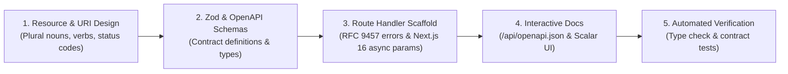

# Next.js 16 OpenAPI Route Handler (`nextjs-api`)

Production runbook for designing, scaffolding, and verifying OpenAPI 3.1-compliant REST route handlers in Next.js 16 App Router (`app/api/**/route.ts`).

---

## Architectural Boundary: Route Handlers vs Server Actions

- **Use Route Handlers (`app/api/**/route.ts`)**: For public REST APIs, mobile clients, external integrations, webhooks, and streaming endpoints (`text/event-stream`). Must adhere to the [OpenAPI Specification](https://spec.openapis.org/oas/latest.html).
- **Use Server Actions (`'use server'`)**: For private internal React mutations, form submissions, and direct cache invalidation (`updateTag`) coupled with React Server Components. Never expose REST endpoints for purely internal React state mutations.

---

## 5-Step Execution Workflow

### Step 1: Resource & URI Modeling
1. Establish plural resource names (e.g., `/api/v1/orders`, not `/api/v1/getOrders`).
2. Map HTTP methods to safe/idempotent semantics (`GET`, `POST`, `PUT`, `PATCH`, `DELETE`, `OPTIONS`).
3. Determine authentication scheme (Bearer JWT, API Key, Session cookie).
4. Review [OpenAPI Specification Guidelines](./references/openapi-spec-guidelines.md).

### Step 2: Schema Definition with Zod
1. Define request, query, and response models using Zod with `.openapi()` metadata annotations.
2. Register schemas and paths into the central OpenAPI registry (`lib/openapi.ts`).
3. Review [Zod to OpenAPI Reference](./references/zod-to-openapi.md) and scaffold from [openapi-registry.ts.template](./resources/templates/openapi-registry.ts.template).

### Step 3: Implement Next.js 16 Route Handlers
1. Create `route.ts` under the target route segment (`app/api/v1/[resource]/route.ts`).
2. Await asynchronous request primitives: `context.params`, `cookies()`, and `headers()`.
3. Support client disconnect abort signals via `request.signal`.
4. Validate incoming payload and query strings via Zod `safeParse`.
5. Return standardized error envelopes using RFC 9457 Problem Details (`application/problem+json`).
6. Apply explicit caching if needed via `"use cache"`, `cacheLife()`, and `cacheTag()`.
7. Reference [Route Handler Patterns](./references/route-handler-patterns.md) and templates:
   - Collection endpoint: [route-standard.ts.template](./resources/templates/route-standard.ts.template)
   - Dynamic entity endpoint: [route-dynamic.ts.template](./resources/templates/route-dynamic.ts.template)
   - Streaming SSE endpoint: [route-streaming.ts.template](./resources/templates/route-streaming.ts.template)
   - Error utilities: [problem-details.ts.template](./resources/templates/problem-details.ts.template)

### Step 4: Expose OpenAPI Document & Interactive UI
1. Expose the compiled JSON specification at `/api/openapi.json` via [docs-route.ts.template](./resources/templates/docs-route.ts.template).
2. Render zero-bundle-overhead interactive documentation at `/api/docs` using [scalar-page.tsx.template](./resources/templates/scalar-page.tsx.template).

### Step 5: Verification & Quality Gate
1. Run static type checking: `pnpm run build` or `pnpm tsc --noEmit`.
2. Verify route response codes, schema conformance, and error payloads using unit/integration tests (Jest or Playwright).
3. Review the complete working reference implementation in [products-api-example.ts](./examples/products-api-example.ts).
