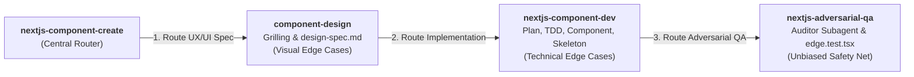

# Next.js Component Creation Orchestrator (`nextjs-component-create`)

A central router that coordinates the end-to-end component lifecycle across three specialized skills without duplicating their logic or templates:



---

## Delegated Skills Map

| Phase | Delegated Skill | Role / Responsibility | Key Deliverables |
| :--- | :--- | :--- | :--- |
| **Phase 1** | [`component-design`](../component-design/SKILL.md) | UX/UI discovery, 3-round adaptive interview, design tokens check, visual asset prompts. | `docs/design/components/[page]/[component]/design-spec.md` with §7 Edge Cases & Boundary States. |
| **Phase 2** | [`nextjs-component-dev`](../nextjs-component-dev/SKILL.md) | Next.js local docs lookup, TDD implementation plan, dictionary sync, component & skeleton authoring. | `[ComponentName].tsx`, `[ComponentName]Skeleton.tsx`, `index.ts`, `[ComponentName].test.tsx`. |
| **Phase 3** | [`nextjs-adversarial-qa`](../nextjs-adversarial-qa/SKILL.md) | Unbiased auditor subagent injection of adversarial edge-case assertions. | `[ComponentName].edge.test.tsx` (immutable, auto-repaired code). |

---

## Sequential Execution Protocol

### Step 1: Route to `component-design` (UX / Visual Specification)

1. Invoke [`.agents/skills/component-design`](../component-design/SKILL.md) passing the target **Page Name** and **Component Name**.
2. **Execute Phase 1 Workflow**:
   - Audit and persist canonical design tokens in `docs/project.json` (`design_system`).
   - Conduct 3-round adaptive grilling (Intent & Tone $\to$ Spatial Hierarchy $\to$ Interactions & Accents).
   - Formulate visual asset prompts for the user (zero direct `generate_image`).
   - Scaffold `design-spec.md` using the canonical template with explicit **§7 Edge Cases & Boundary States** (overflow limits, empty states, error cards, and extreme viewports).
   - Run independent subagent UX audit (`invoke_subagent`).
3. **Gate**: Do not proceed until `docs/design/components/[page]/[component]/design-spec.md` is complete and verified.

### Step 2: Route to `nextjs-component-dev` (TDD Engineering & Implementation)

1. Invoke [`.agents/skills/nextjs-component-dev`](../nextjs-component-dev/SKILL.md), feeding `design-spec.md` as the specification input.
2. **Execute Phase 2 Workflow**:
   - Query local Next.js distribution docs at `node_modules/next/dist/docs/` via `codebase-memory` MCP.
   - Author `implementation_plan.md` featuring **§5.2 TDD Edge Case Test Matrix** (translating design-spec edge cases into concrete Jest and Playwright assertions) and obtain approval.
   - Verify dev server connectivity via `next-devtools` MCP (`nextjs_index`).
   - Populate `messages/[locale].json` across all supported languages in `docs/project.json` (zero hardcoding).
   - Author TDD baseline unit tests (`[ComponentName].test.tsx`) before writing component JSX.
   - Implement primary component (`[ComponentName].tsx`), matching Suspense skeleton (`[ComponentName]Skeleton.tsx`), and barrel (`index.ts`).
   - Run runtime diagnostics via `next-devtools` (`nextjs_call`) to verify 0 hydration warnings.
3. **Gate**: Do not proceed until baseline unit tests pass and dev server reports zero errors.

### Step 3: Route to `nextjs-adversarial-qa` (Adversarial Edge-Case Injection)

1. Invoke [`.agents/skills/nextjs-adversarial-qa`](../nextjs-adversarial-qa/SKILL.md) targeting the completed component directory.
2. **Execute Phase 3 Workflow**:
   - Spawn independent subagent (`Role: "Adversarial Code & QA Auditor"`).
   - Auditor subagent reviews code and injects `[ComponentName].edge.test.tsx` targeting blind spots: boundary inputs, Unicode/RTL strings, conflicting props, and rapid re-render stress.
   - Execute targeted edge tests: `pnpm test -- <target_component_dir>/[ComponentName].edge.test.tsx`.
   - **Fix the Code, Not the Tests**: If any adversarial test fails, modify the component implementation until all tests pass with 0 errors.

### Step 4: Final Verification & Plan Synchronization

1. Execute the component verification script to audit all companion files and test suites:
   - **Windows**: `powershell -ExecutionPolicy Bypass -File .agents/skills/nextjs-component-create/scripts/verify-component-create.ps1 -ComponentPath <target_component_dir>`
   - **Linux / macOS**: `bash .agents/skills/nextjs-component-create/scripts/verify-component-create.sh <target_component_dir>`
2. Check off the completed component item (`- [x]`) in `docs/plan/05-pages-and-components.md` per Rule 35.

---

## Execution Report Template

Always output this report upon concluding the orchestrated workflow:

```markdown
## 🧩 Next.js Component Creation Report: [ComponentName]

| Phase / Routed Skill                 | Key Deliverable(s)                                                              | Status      | Notes / Details                                                  |
| :----------------------------------- | :------------------------------------------------------------------------------ | :---------- | :--------------------------------------------------------------- |
| **1. component-design**              | `docs/design/components/[page]/[component]/design-spec.md`                      | `[PASSED]`  | UX hierarchy, tokens, §7 Edge Cases, and subagent audit.         |
| **2. nextjs-component-dev**          | `[ComponentName].tsx`, `[ComponentName]Skeleton.tsx`, `[ComponentName].test.tsx`| `[PASSED]`  | TDD plan with Edge Case Matrix, dictionary sync, and unit tests. |
| **3. nextjs-adversarial-qa**         | `[ComponentName].edge.test.tsx`                                                 | `[PASSED]`  | Auditor subagent injected immutable edge tests; 100% passing.   |
| **4. Final Verification**            | `verify-component-create.ps1` / `.sh`                                           | `[PASSED]`  | All companion files, dictionaries, and test assertions verified. |
```
