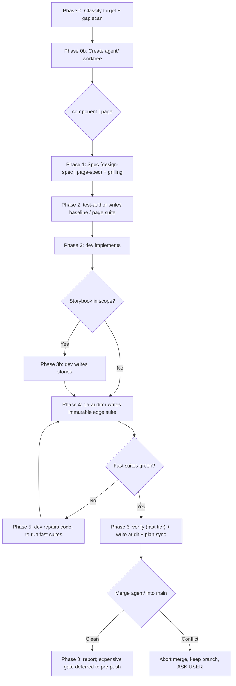

# Next.js Creation Orchestrator (`nextjs-component-create`)

The single canonical orchestrator for creating or backfilling production-ready Next.js App Router **components and pages**. It sequences UX grilling, TDD implementation, conditional Storybook, and independent adversarial QA, and it delegates each phase to a dedicated OpenCode agent whose write access is enforced by permissions.

> [!TIP]
> **Modular Assets:**
> - Orchestration, delegation, and handoff contracts: [`references/orchestration-and-delegation.md`](./references/orchestration-and-delegation.md)
> - Worktree isolation & merge protocol: [`../nextjs-dev-setup/references/agent-worktree-isolation.md`](../nextjs-dev-setup/references/agent-worktree-isolation.md)
> - Test execution tiers (fast vs pre-push): [`../nextjs-adversarial-qa/references/shared/test-execution-tiers.md`](../nextjs-adversarial-qa/references/shared/test-execution-tiers.md)
> - Architecture & folder rules: [`references/architecture-standards.md`](./references/architecture-standards.md)
> - Anti-patterns & pitfalls: [`references/pitfalls.md`](./references/pitfalls.md)
> - Reference implementations: [`examples/`](./examples/)
> - JSON plan schema: [`resources/plan-schema.json`](./resources/plan-schema.json)
> - Verification: [`scripts/verify-component-create.ps1`](./scripts/verify-component-create.ps1) / [`.sh`](./scripts/verify-component-create.sh)
> - Write audit: [`scripts/audit-agent-writes.ps1`](./scripts/audit-agent-writes.ps1) / [`.sh`](./scripts/audit-agent-writes.sh)

---

## Phase Pipeline



---

## Execution Tiers & Isolation (applies to every phase)

1. **Fast tier only.** Every in-pipeline run is Jest, targeted to the files under
   test. Playwright, the full Jest project, `build`, and Storybook builds are the
   **expensive tier** and run at `git push` through `.husky/pre-push`.
2. **Authored ≠ executed.** E2E specs are still written in Phases 2 and 4; they are
   statically audited and declared in `deferred_expensive_tests[]`. Report them as
   `DEFERRED (pre-push)`, never `PASS`.
3. **One worktree per target.** All implementation writes happen on branch
   `agent/<slug>` in a dedicated worktree. The orchestrator creates it, and the
   orchestrator merges it into `main` after Phase 6.
4. **Conflicts stop the pipeline.** Abort the merge, keep the branch, report the
   conflicting paths, and ask the user to choose. Never resolve by inference.
   Contracts: [`test-execution-tiers.md`](../nextjs-adversarial-qa/references/shared/test-execution-tiers.md),
   [`agent-worktree-isolation.md`](../nextjs-dev-setup/references/agent-worktree-isolation.md).

---

## Delegated Agents

Agents are installed by `nextjs-dev-setup` into `.opencode/agents/`. The orchestrator is the only agent allowed to spawn them.

| Phase | Agent | Responsibility | May write |
| :--- | :--- | :--- | :--- |
| **0** | `nextjs-orchestrator` | Classify target, resolve paths, decide scratch vs backfill | plan, docs |
| **1** | `nextjs-orchestrator` | Grilling, spec authoring, UX audit gate | `design-spec.md`, `page-spec.md` |
| **2** | `nextjs-test-author` | `test-plan.md` + baseline unit suite, or page E2E suite | tests only |
| **3** | `nextjs-dev` | Component/page, skeleton, boundaries, dictionaries, barrel | implementation only |
| **3b** | `nextjs-dev` | Storybook stories, only when the skill is invoked | `*.stories.tsx` |
| **4** | `nextjs-qa-auditor` | Immutable edge suite + component E2E + audit report | edge tests only |
| **5** | `nextjs-dev` | Repairs implementation from `code_fixes_required[]` | implementation only |
| **6** | `nextjs-orchestrator` | Verification, write audit, plan checklist sync, report | plan, docs |

Test authoring standards live only in [`nextjs-adversarial-qa`](../nextjs-adversarial-qa/SKILL.md). Never duplicate Jest or Playwright templates here.

---

## Phase 0: Classify, Load Context & Gap Analysis

1. **Load context.** Read `docs/project.json`, `docs/plan/05-pages-and-components.md`, `docs/design/03-ui-design-tokens.md`, `docs/design/02-sitemap-and-routes.md`, `lib/routes.ts`, and `lib/site-config.ts`.
2. **Resolve paths.** Never guess `new_component_dir`, `dictionaries_dir`, package manager, or locales.
3. **Classify the target:**
   - `component` — a section, card, widget, or layout element.
   - `page` — a route under `app/[locale]/<route>/` including `page.tsx`, `loading.tsx`, `error.tsx`, metadata, and JSON-LD.
   - `page + components` — a page that needs new section components; run the page track and route each new component through Phases 2–4.
4. **Decide the mode:**
   - **Scratch Mode** — target missing: run Phases 1 → 8.
   - **Companion Backfill Mode** — target exists: preserve the existing implementation, audit companions, and run only the phases that own missing artifacts.
5. **Check the roster.** If `.opencode/agents/` lacks the three role agents, stop with `BLOCKED: agent roster missing - run nextjs-dev-setup`. Degraded mode is allowed only for non-OpenCode harnesses and must be announced.
6. **Storybook scope.** Include `.stories.tsx` only when `nextjs-storybook-story` is invoked or the user explicitly requests stories.
7. **Create the worktree.** Before any write, create the isolated branch off `main`:
   - **Windows:** `pwsh .agents/skills/nextjs-dev-setup/scripts/agent-worktree.ps1 -Action create -Slug <kebab-target-slug>`
   - **Linux / macOS:** `bash .agents/skills/nextjs-dev-setup/scripts/agent-worktree.sh create <kebab-target-slug>`
   - Record the branch (`agent/<slug>`) and path in the plan and the report. Every delegate in Phases 2–5 receives `worktree:` in its brief.
8. **Confirm the pre-push gate exists.** The expensive tier needs `.husky/pre-push`. If it is missing, report `BLOCKED: pre-push gate missing - run nextjs-dev-setup N12`; never replace it with a full local run.

Full rules: [`references/architecture-standards.md`](./references/architecture-standards.md).

---

## Phase 1: Specification & Grilling

### Component track
1. Invoke [`component-design`](../component-design/SKILL.md) with the target page and component names.
2. Execute its workflow: token audit, 3-round adaptive grilling, visual asset prompts (no direct image generation), and `design-spec.md` scaffolding with explicit **§7 Edge Cases & Boundary States**.
3. Run the independent UX audit.
4. **Gate:** do not proceed until `design-spec.md` is complete and verified.

### Page track
1. Invoke [`nextjs-page-dev`](../nextjs-page-dev/SKILL.md) and scaffold `page-spec.md` from its [template](../nextjs-page-dev/resources/templates/page-spec.template.md).
2. Grill one round on: route and locale variants, above-the-fold intent, data sources and caching, error/empty/loading behavior, metadata and JSON-LD type, and internal linking.
3. **Gate:** `page-spec.md` §7 covers metadata, structured data, locale routing, boundaries, and empty/error states.

**Backfill mode:** skip when a verified spec already exists.

---

## Phase 2: TDD Baseline (`nextjs-test-author`)

1. Delegate to `nextjs-test-author` in `baseline` mode (components) or `page` mode (routes).
2. Pass: spec path, target paths, worktree path/branch, `docs/project.json`, package manager, locales, dictionaries dir, and the immutable-edge rule.
3. The agent returns `test-plan.md`, the test files, and a JSON status. It cannot edit implementation.
4. **Gate (fast tier):**
   - `baseline` mode: the targeted Jest suite runs and fails **only** because the implementation does not exist yet. A syntax error, import failure, or broken provider setup is a blocker; do not proceed until the suite executes.
   - `page` mode: the Playwright suite is **authored and statically audited**, then deferred. Do not launch a browser in this phase.
   Record the command and exit code either way; add every deferred file to `deferred_expensive_tests[]`.
5. **Backfill mode:** run only if tests are missing.

---

## Phase 3: Implementation (`nextjs-dev`)

1. Delegate to `nextjs-dev` with the approved spec, `implementation_plan.md`, the worktree path, and (on a repair round) `code_fixes_required[]`.
2. The agent must query local Next.js docs at `node_modules/next/dist/docs/` via `codebase-memory`, verify the dev server via `next-devtools` (`nextjs_index`), and populate `messages/[locale].json` for every supported language.
3. It implements the component/page, skeleton or `loading.tsx`, `error.tsx`, barrel exports, metadata, and JSON-LD as the track requires — inside the worktree only.
4. **Gate (fast tier):** `verify-dev` / `verify-page` passes, the targeted Jest baseline suite passes, and the dev server reports no compilation or hydration errors. No Playwright, no full Jest project, no production build.
5. **Backfill mode:** skip implementation; run only the missing companions.

### Phase 3b: Storybook (conditional)
Run only when in scope. Delegate `nextjs-storybook-story` to `nextjs-dev`, then verify with `verify-storybook.ps1` / `.sh`. Storybook smoke/build is expensive tier: it runs here only because the skill was explicitly invoked, never during standard component development.

---

## Phase 4: Adversarial Audit (`nextjs-qa-auditor`)

1. Delegate in `adversarial` mode with the implementation, skeleton, baseline suite, spec §7, and the worktree path.
2. The auditor diffs baseline coverage, then writes the immutable `[ComponentName].edge.test.tsx` and the component Playwright spec.
3. It returns `failures[]`, `code_fixes_required[]`, `deferred_expensive_tests[]`, and `immutable_edits[]` (must be empty).
4. Run the edge suite in the fast tier: `pwsh verify-qa.ps1 -TargetPath <dir> -Mode adversarial` (Jest only). The Playwright spec is audited statically and deferred to pre-push — no browser launches in this phase.

---

## Phase 5: Repair Loop (orchestrator-owned)

1. Route every `code_fixes_required[]` item to `nextjs-dev`. Never to a test agent.
2. `nextjs-dev` fixes implementation only, then the owning test agent re-runs the same files (fast tier).
3. Repeat until every targeted fast suite exits `0`.
4. Expensive-tier failures surface at pre-push; treat them as a Phase 5 entry and reopen the loop on the same branch.
5. Escalation:
   - **Baseline test wrong** → `nextjs-test-author` may fix it and must record the reason.
   - **Edge test wrong** → stop and ask the user; the orchestrator applies the change and logs it.
   - **Spec ambiguous** → `BLOCKED: ambiguous specification` with the rows in question.

---

## Phase 6: Final Verification, Write Audit & Plan Sync

1. Run the end-to-end gate in the **fast tier**:
   - **Component:** `powershell -ExecutionPolicy Bypass -File .agents/skills/nextjs-component-create/scripts/verify-component-create.ps1 -ComponentPath <target_dir>`
   - **Page:** `... -ComponentPath <route_dir> -TargetKind page`
   - **Linux / macOS:** `bash .agents/skills/nextjs-component-create/scripts/verify-component-create.sh <target_dir> [component|page]`
   - It reports the expensive tier as `[DEFERRED]`. That is the expected result, not a failure.
2. Run the write audit: `scripts/audit-agent-writes.ps1 -TargetKind <kind> -Since <pre-phase-ref>`. A violation means a role wrote outside its boundary; restore the file and report it.
3. Check off completed items (`- [x]`) in `docs/plan/05-pages-and-components.md`; tick the parent page only when every sub-item is complete. Only the orchestrator does this.
4. Report using the template below, including the worktree branch, the merge result, and the deferred suites.

## Phase 7: Merge into `main`

1. Confirm the worktree is clean: every change is committed on `agent/<slug>`.
2. From the main worktree:
   - **Windows:** `pwsh .agents/skills/nextjs-dev-setup/scripts/agent-worktree.ps1 -Action merge -Slug <slug>`
   - **Linux / macOS:** `bash .agents/skills/nextjs-dev-setup/scripts/agent-worktree.sh merge <slug>`
3. The helper merges with `--no-ff`. On success, continue to Phase 8.
4. **On conflict the helper exits `3`** after aborting the merge; `main` stays clean and the branch is intact. Stop the pipeline and ask the user:
   - the conflicting paths,
   - which side changed what,
   - **A)** rebase the agent branch onto `main` and re-merge, **B)** keep `main` and drop the conflicting hunk, **C)** the user resolves manually.
   Never pick an option yourself, never use `-X ours`/`-X theirs`, never force-push. Log the choice and resolution in the report.
5. Do not `git push` and do not use `--no-verify`. The expensive tier runs when the user pushes.

## Phase 8: Report & Handoff

1. Render the report with tier status per phase (`[PASSED]` / `[DEFERRED]` / `[FAILED]`).
2. State the expensive gate explicitly: `DEFERRED → .husky/pre-push (test:all)`.
3. Remove the worktree only after the merge is accepted: `agent-worktree.ps1 -Action remove -Slug <slug>`.
4. Leave pushing to the user.

---

## Core Invariants

- **RSC by default**, `"use client"` pushed to leaves; never import an RSC inside a Client file.
- **Semantic tokens only**; no hardcoded colors, no physical directional classes.
- **Zero hardcoded copy**; every string lives in `messages/[locale].json` across all supported locales.
- **Strict English TSDoc** on all exports and props.
- **One role per artifact**: dev never edits tests, test agents never edit implementation, only the auditor writes edge tests.
- **Edge tests are immutable**; baseline tests change only with a logged reason.
- **Never overwrite an existing component or page**; enter Companion Backfill Mode instead.
- **The orchestrator ticks the plan**, not the role agents.
- **Fast tier only in-pipeline**; the expensive tier (Playwright, full Jest, builds) runs at pre-push and is reported `DEFERRED`, never `PASS`.
- **One worktree per target**; all writes happen on `agent/<slug>`, and only the orchestrator merges into `main`.
- **Merge conflicts belong to the user**; abort, keep the branch, and ask.

---

## Execution Report Template

```markdown
## 🧩 Next.js Creation Report: [TargetName]

| Phase / Agent                | Key Deliverable(s)                                                   | Status                | Notes |
| :--------------------------- | :------------------------------------------------------------------- | :-------------------- | :---- |
| **0. Classification**        | kind: `component` / `page`; mode: `scratch` / `companion_backfill`    | `[PASSED]`            | |
| **1. Spec**                  | `design-spec.md` / `page-spec.md` §7                                  | `[PASSED]`            | |
| **2. test-author**           | `test-plan.md`, `*.test.tsx` / `tests/e2e/pages/*.spec.ts`            | `[PASSED]`            | command + exit code |
| **3. dev**                   | implementation, skeleton, `loading.tsx`/`error.tsx`, dictionaries     | `[PASSED]`            | |
| **3b. Storybook**            | `*.stories.tsx`                                                       | `[PASSED]`/`[SKIPPED]`| only when in scope |
| **4. qa-auditor**            | `*.edge.test.tsx`, `tests/e2e/components/**`                          | `[PASSED]`            | `immutable_edits: []` |
| **5. Repair**                | `code_fixes_required[]` → dev → re-run                                | `[PASSED]`            | |
| **6. Verify + write audit**  | `verify-*` (fast tier) + `audit-agent-writes`                         | `[PASSED]`            | all fast gates exit 0 |
| **7. Merge**                 | `agent/<slug>` → `main` (`--no-ff`)                                   | `[PASSED]`/`[BLOCKED]`| conflict → user decision |
| **8. Expensive tier**        | Playwright + full Jest + build                                        | `[DEFERRED]`          | runs at `git push` (pre-push) |
```

Deferred files, verbatim:

```text
deferred_expensive_tests:
  - tests/e2e/components/<page>/<ComponentName>.spec.ts
  - .husky/pre-push → <pm> run test:all
```

---

## Reference Index

- [Orchestration & Delegation](./references/orchestration-and-delegation.md) — pipeline, agent contracts, payloads, audit.
- [Worktree Isolation & Merge](../nextjs-dev-setup/references/agent-worktree-isolation.md) — branch layout, merge protocol, conflict escalation.
- [Test Execution Tiers](../nextjs-adversarial-qa/references/shared/test-execution-tiers.md) — fast vs expensive, pre-push gate.
- [Architecture Standards](./references/architecture-standards.md) — context, RSC, folder layout, styling, TanStack, i18n, backfill.
- [Pitfalls](./references/pitfalls.md) — creation and testing anti-patterns.
- [Plan Schema](./resources/plan-schema.json) — structured plan/report payload.
- [Examples](./examples/) — RSC and TanStack reference implementations.
