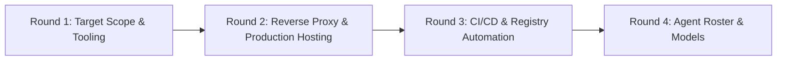

# Interactive Multi-Round Setup Interview (Grilling Runbook)

Conduct the developer setup interview in **progressive, adaptive rounds**. Do not dump a monolithic form. Stop and wait for the user to respond after each round before formulating the next round's questions.

---

## Round 1: Target Scope & Developer Tooling

Probe the user to determine which architectural layers should be scaffolded and enabled in `docs/project.json`:

1. **Framework Core & Agent Rules**:
   - Always install the latest release of Next.js (`<pkg_mgr> add next@latest react@latest react-dom@latest`).
   - Scaffold or update root `AGENTS.md` (or `agent.md`) with the mandatory notice alerting AI agents that their pre-trained context is outdated and mandating local documentation lookup in `node_modules\next\dist\docs`.
2. **Testing Suites**:
   - Unit Testing (Jest + React Testing Library)?
   - E2E & Instant Navigation Testing (Playwright)?
   - Component Workshop (Storybook CSF3 + Accessibility addon)?
2. **Internationalization & Locales (`next-intl`)**:
   - Supported languages, default locale, and directionality (e.g. English `en` [LTR], Persian `fa` [RTL])? *Auto-discovered from `docs/adr/`, `CONTEXT.md`, or `docs/plan.md` per Zero-Interruption Rule.*
3. **AI & Code Intelligence MCP Servers**:
   - Next.js Dev Server (`next-devtools`)?
   - Playwright MCP for browser automation?
   - Storybook MCP for visual story inspection?
   - Codebase Memory Graph MCP (`codebase-memory-mcp` with `auto_watch=false`)?
4. **Styling & Design Tokens**:
   - Enforce `@shadcn/lint` and ESLint flat config design token verification?

---

## Round 2: Reverse Proxy & Production Hosting Strategy

Probe the user on the production deployment topology, domain routing, and reverse proxy layer:

1. **Hosting & Reverse Proxy Selection**:
   - **Traefik via Docker Compose**: Automated container discovery using dynamic Compose labels reading from environment variables (`${DOMAIN_NAME}`, `${TRAEFIK_ENTRYPOINT}`, `${TRAEFIK_CERTRESOLVER}`) with anti-buffering middleware.
   - **Nginx via Host System**: Static site configuration in `/etc/nginx/sites-available/<domain>` using Certbot SSL certificates.
   - **Standalone Node / Direct Port**: Running directly on host port without reverse proxy labels.
2. **Domain & Environment Variable Settings**:
   - What is the production domain / base URL (e.g. `https://example.com`)?
   - What environment variables will configure Traefik / container runtime (`DOMAIN_NAME`, `PORT`, `CONTAINER_NAME`)?
   - What is the Certbot domain path for SSL certificates (e.g. `/etc/letsencrypt/live/example.com/`)?
3. **Server Action & Anti-Buffering Safeguards**:
   - Confirm allowed origins for Server Actions (`example.com`, `*.example.com`, `localhost:3000`).
   - Confirm reverse proxy anti-buffering (`X-Accel-Buffering: no`) for Suspense streaming and Partial Prerendering (PPR).

---

## Round 3: CI/CD, Registry Packaging & Git Hooks

Probe the user on repository automation, versioning, and commit conventions:

1. **Git Hooks**:
   - Enable Husky commit-msg checking (`@commitlint/config-conventional`)?
   - Enable Husky pre-push dual test validation (`pnpm run test:all`)?
2. **GitHub Actions CI/CD**:
   - Enable Google Release Please for automated SemVer release PRs and changelogs?
   - Enable automated multi-arch Docker image compilation (AMD64 + ARM64) to GitHub Container Registry (GHCR)?

---

## Round 4: Agent Roster & Models

Short round. The 3-role roster is the contract; do not offer a 2-role downgrade.

1. **Roster Confirmation**:
   - Install `nextjs-dev`, `nextjs-test-author`, `nextjs-qa-auditor`, and the `nextjs-orchestrator` primary agent?
   - Install the `/create-nextjs-component` and `/create-nextjs-page` command shortcuts?
2. **Model Overrides** (default: inherit the primary agent's model):
   - Orchestrator model?
   - Implementation (`nextjs-dev`) model?
   - Test author model?
   - QA auditor model?
   - Record every choice in `docs/project.json` → `project_context_and_metadata.agents`; leave `null` to inherit.
3. **Boundary Confirmation**:
   - Confirm the operator understands that `nextjs-dev` cannot edit tests, both test agents cannot edit implementation, and edge tests are immutable after creation.
   - Confirm the repair rule: failing assertions go to the dev agent, not to a test agent.

> [!NOTE]
> Do not ask about agent roster in Round 1. Later rounds depend on the roster being
> settled, so it runs last and the plan can deploy it in one pass.

---

## Post-Interview Execution Protocol

Present the `implementation_plan.md` artifact summarizing all agreed choices, then
proceed directly with execution without waiting for manual confirmation.
