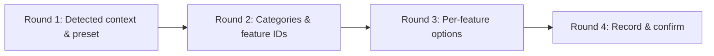

# Feature-Driven Setup Interview

Conduct the setup interview in **progressive, adaptive rounds**. Stop and wait for
the user after each round. Never dump a monolithic form, and never ask for facts
that the repository already answers.

The menu, presets, and confirmation/report blocks live in
[feature-selection-interview.md](../resources/templates/feature-selection-interview.md).
This document holds the detailed question sets.

---

## Round 1 — Detected context & preset

Report the detected stack, package manager, source layout, MCP servers, `gh`
state, Docker availability, and existing setup files. Then ask only:

> Which preset should I use — Minimal, Standard, Full, or Custom?

Do not repeat detection results as questions. Ask for a missing value only when
the repository is genuinely ambiguous (for example both `app/` and `src/app/`
exist, or no lockfile is present).

---

## Round 2 — Categories & specific feature IDs

Present the four categories and their features with defaults. Ask:

> Which categories should I keep, and do you want to name any specific features
> (N1–N12) to add or drop?

Rules:

- A category selection enables its default-on features only; it does not silently
  enable default-off features (`N7`, `N11`).
- Explicit IDs always win over the category default.
- Record every add/remove and resolve dependencies immediately (see the
  dependency table in the interview template).
- State the resulting `[BLOCKED]` or degraded outcome before moving on.

---

## Round 3 — Per-feature options (enabled only)

### Category A — Foundation

- **N2 Framework core**: source layout; providers file; environment templates;
  global boundaries; editor launch config.
- **N3 Icons & PWA**: favicon source; app name/short name; theme and background
  color; icon set (192, 512, maskable).
- **N4 Internationalization**: locales and default; `localePrefix` (`always` or
  `as-needed`); dictionaries directory; RTL locales; migrate routes into
  `app/[locale]/` now or later; confirm `proxy.ts` (Next 16+) vs `middleware.ts`.

### Category B — Testing & Quality

- **N5 Jest**: environment (`jsdom`/`node`); coverage thresholds; script names.
- **N6 Playwright**: browsers; base URL and port; instant-navigation experiments;
  whether `test:all` includes E2E.
- **N7 Storybook**: builder preset; accessibility addon; story location; register
  Storybook MCP.
- **N8 Design-system lint**: token stylesheet; rule severity; lint command.

### Category C — Agents

- **N9 Agent roster**: confirm the three-role roster plus orchestrator; model
  overrides per role (default `null` = inherit); command shortcuts; boundary
  acknowledgement.

> [!NOTE]
> Do not offer a two-role downgrade. The independent QA auditor is the contract.
> Record every model choice in `docs/project.json` → `project_context_and_metadata.agents`.

### Category D — Delivery & Operations

- **N10 MCP servers**: accepted servers; install `codebase-memory-mcp` or skip;
  workspace-only vs global (Antigravity reads only global config); first index
  mode (`fast`/`moderate`).
- **N11 Docker & proxy**: image only vs compose; Traefik via Compose labels vs
  Nginx on the host vs none; domain, port, container name; non-root user;
  Server Actions allowed origins; `NEXT_SERVER_ACTIONS_ENCRYPTION_KEY` source.
- **N12 Git hooks & CI/CD**: `commit-msg` and `pre-push`; gate level (`test:all`,
  lint only, none); Release Please; multi-arch GHCR publishing (requires N11);
  issue forms, PR template, and remote labels.

---

## Round 4 — Record, plan, and execute

1. Write `.agents/nextjs-setup-features.json` from
   [nextjs-setup-features.schema.json](../resources/templates/nextjs-setup-features.schema.json).
2. Merge `nextjs_setup_features` into `docs/project.json` when N1 is enabled.
3. Present the confirmation block and wait for approval.
4. Generate the `implementation_plan.md` artifact listing every planned package,
   file, and config delta in dependency order.
5. Execute the enabled features without further confirmation, then verify.

---

## Question-writing rules

- One topic per question; offer a recommended option first and label it
  `(Recommended)`.
- Never ask a question that the selection already answers.
- Prefer multi-select for independent toggles (servers, suites, icons) and
  single-select for mutually exclusive choices (proxy type, package manager).
- When the user declines to choose, apply the documented default and say so in
  the plan.
