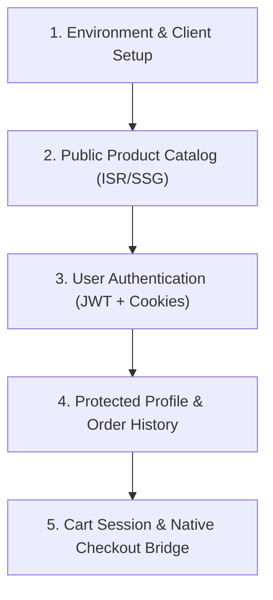

# Next.js WooCommerce Integration (`nextjs-woocommerce`)

Operational runbook and checklist for architecting, querying, and integrating Next.js App Router applications with a headless WooCommerce backend via WPGraphQL, WooGraphQL, and JWT Authentication.

---

## Prerequisites & Documentation References

- [ ] Next.js 14+ project initialized with App Router and TypeScript.
- [ ] Active WooCommerce backend with **WPGraphQL**, **WooGraphQL**, and **wp-graphql-jwt-authentication**.
- [ ] For complete API schemas and Next.js code patterns, consult [nextjs-woocommerce-reference.md](./references/nextjs-woocommerce-reference.md).
- [ ] For reusable data-fetching client implementation, see [woocommerce-fetcher.ts](./examples/woocommerce-fetcher.ts).

---

## Step-by-Step Implementation Checklist

### Phase 1: Environment & Client Configuration
- [ ] **Configure Environment Variables**:
  - Add `NEXT_PUBLIC_WORDPRESS_API_URL=https://your-store.com/graphql` to `.env.example` and `.env.development`.
  - Add `NEXT_PUBLIC_WORDPRESS_URL=https://your-store.com` for checkout redirects.
- [ ] **Setup Universal Fetcher**:
  - Implement [woocommerce-fetcher.ts](./examples/woocommerce-fetcher.ts) supporting ISR caching and auth headers.

### Phase 2: Public Product Catalog & Taxonomies
- [ ] **Category Navigation**: Query `productCategories` with `hideEmpty: true` for headers and category menus.
- [ ] **Product Grid Archive**: Query `products` using union fragments (`... on SimpleProduct`, `... on VariableProduct`). Configure `next: { revalidate: 300, tags: ['products'] }`.
- [ ] **Product Detail Page**: Pre-render dynamic routes (`app/products/[slug]/page.tsx`) with `generateStaticParams()` querying all product slugs.

### Phase 3: JWT Authentication Pipeline
- [ ] **Login Mutation**: Implement Server Action executing `login(input: { username, password })`.
- [ ] **Cookie Storage**: Store returned `authToken` in a secure `HttpOnly` cookie (`auth_token`).
- [ ] **Session Binding**: If customer returns `sessionToken`, store in `wc_session` cookie.
- [ ] **Logout**: Clear auth cookies on user logout.

### Phase 4: Protected User Data & Orders
- [ ] **Customer Profile**: Query `viewer { id name email }` passing `Authorization: Bearer <authToken>`.
- [ ] **Order History**: Query `customer { orders { nodes { id orderNumber total status } } }` with `cache: 'no-store'`.

### Phase 5: Cart Management & Checkout Strategy
- [ ] **Cart State**: Capture and persist `woocommerce-session` header returned on `addToCart` mutations.
- [ ] **Native Checkout Bridge**:
  - Redirect users to `https://your-store.com/checkout` to leverage native WooCommerce payment gateways (ZarinPal, Mellat, Stripe), regional logistics, and compliance seals without custom gateway rewrites.

---

## Edge Cases & Known Pitfalls

1. **Static vs. Dynamic De-optimization**: Reading cookies in the root layout or product pages switches Next.js into full SSR dynamic mode. Only read auth cookies inside Server Actions, Route Handlers, or isolated account dashboard sub-trees (`app/account/...`).
2. **Polymorphic Fragments**: Direct queries like `products { nodes { price } }` will fail validation in WooGraphQL. Always wrap pricing and variations in `... on SimpleProduct` and `... on VariableProduct`.
3. **Session Loss**: When adding items to cart, failing to resend the `woocommerce-session` header creates a new empty cart on every mutation.
4. **CORS on GraphQL Endpoint**: Ensure WordPress sends `Access-Control-Allow-Origin` and `Access-Control-Allow-Headers: Authorization, Content-Type, woocommerce-session` headers for your Next.js domain.

---

## Verification & Pre-flight Testing

- [ ] `pnpm build` succeeds with static generation of product pages.
- [ ] Test login form issues `auth_token` and redirects to dashboard.
- [ ] Account page renders customer details and order list with valid token.
- [ ] Add-to-cart updates cart item count across multiple client requests.
