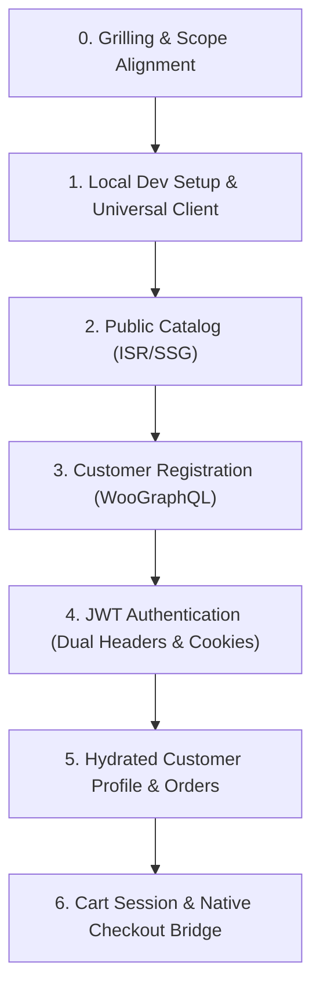

# Next.js WooCommerce Integration (`nextjs-woocommerce`)

Operational runbook and checklist for architecting, querying, and integrating Next.js App Router applications with a headless WooCommerce backend via WPGraphQL, WooGraphQL, and JWT Authentication.

---

## Prerequisites & Documentation References

- [ ] Next.js 14+ project initialized with App Router and TypeScript.
- [ ] Active WooCommerce backend with **WPGraphQL**, **WooGraphQL**, and **wp-graphql-jwt-authentication**.
- [ ] For complete API schemas and Next.js code patterns, consult [nextjs-woocommerce-reference.md](./references/nextjs-woocommerce-reference.md).
- [ ] For reusable data-fetching client implementation, see [woocommerce-fetcher.ts](./examples/woocommerce-fetcher.ts).

---

## Step-by-Step Implementation Checklist

### Phase 0: Interactive Grilling & Scope Alignment (Mandatory First Step)
Before writing or altering any code, the agent **MUST** grill the user to determine the exact goals for the workflow:
1. **Scope & Architecture**:
   - Is this an end-to-end full storefront, or a targeted capability (e.g. product catalog, auth, cart session, or checkout transfer)?
   - Are you deploying with a single-domain reverse proxy (Traefik) or across decoupled origins?
2. **Catalog & Product Modeling**:
   - Does the store use simple products only, or variable products with attributes/swatches?
3. **Cart & Checkout Behavior**:
   - Headless cart with native checkout transfer (recommended for custom shipping and Iranian payment gateways), or headless order creation?
4. **Local Development Needs**:
   - Do you need the local development environment orchestrated with WordPress and Traefik?

### Phase 1: Local Development Environment & Universal Fetcher Setup
- [ ] **Unified Domain Routing (Traefik Reverse Proxy)**:
  - Both Next.js and WordPress run under the same domain (`shop.local` locally, `shop.meetjamali.com` in production) to eliminate third-party cookie blocks.
  - **WordPress Priority Routing (`priority: 100`)**: Intercepts `/checkout`, `/my-account`, `/wc-api`, `/wp-admin`, `/wp-login.php`, `/wp-content`, `/wp-includes`, `/wp-json`, `/graphql`, and query parameters `QueryRegexp('wc-ajax', '.+') || QueryRegexp('wc-api', '.+')`.
  - **Next.js Priority Routing (`priority: 10`)**: Catch-all for storefront routes (`/`, `/products`, `/cart`, `/_next/*`).
- [ ] **Local Dev Server Proxy (`docker-compose.dev.yml`)**:
  - Run Next.js on the host (`pnpm run dev` on port 3000) for hot-reloading.
  - Run a lightweight dev proxy container (e.g. Caddy/Nginx) forwarding traffic to `host.docker.internal:3000` attached to `my_network` with Next.js Traefik labels so `https://shop.local/` routes directly to the dev server.
- [ ] **WordPress Healthcheck Tuning**:
  - Configure the WordPress container healthcheck to test `http://localhost:80/wp-includes/version.php` instead of `/` to avoid 15–20s timeouts on boot that cause Traefik to evict the backend.
- [ ] **Windows Docker I/O Performance Tuning (Named Volumes & WSL2)**:
  - If developing on Windows hosts, do NOT bind-mount the full WordPress core or MySQL directory directly from NTFS (`C:\`, `D:\`). Use Docker named volumes (`wp_core`, `wp_db_data`) while mounting only `wp-content`, or run the repository inside the WSL2 native filesystem (`/home/<user>/...`) to prevent 15s–45s page loads. In local development, add `define('DISABLE_WP_CRON', true);` and `define('WP_POST_REVISIONS', false);`.
- [ ] **WordPress PHP PDO Driver (`pdo_mysql`)**:
  - Deploy standard `wordpress:latest` containers without creating custom Docker images, and patch them after deployment via the Makefile target (`make patch-pdo-mysql` or `make patch-wordpress`). Standard `wordpress:latest` images lack `pdo_mysql`, causing plugins utilizing Laravel Capsule / Eloquent (such as Persian WooCommerce `persian-woocommerce` and Gateland) to throw unhandled `Illuminate\Database\QueryException: could not find driver` and crash the admin dashboard with HTTP 500 errors.
- [ ] **Configure Environment Variables**:
  - Add `NEXT_PUBLIC_WORDPRESS_API_URL=https://shop.local/graphql` to `.env.development` and `https://shop.meetjamali.com/graphql` to `.env.example`.
  - Add `NEXT_PUBLIC_WORDPRESS_URL=https://shop.local` (dev) and `https://shop.meetjamali.com` (prod).
- [ ] **Setup Universal Fetcher**:
  - Implement [woocommerce-fetcher.ts](./examples/woocommerce-fetcher.ts) supporting dual auth headers (`Authorization: Bearer` and `X-JWT-Auth`), ISR revalidation, and resilient response parsing (handling WordPress HTTP 403 status on valid data).

### Phase 2: Public Product Catalog & Taxonomies
- [ ] **Category Navigation**: Query `productCategories` with `hideEmpty: true` for headers and category menus.
- [ ] **Product Grid Archive**: Query `products` using polymorphic union fragments (`... on SimpleProduct`, `... on VariableProduct`). Configure `next: { revalidate: 300, tags: ['products'] }`.
- [ ] **Product Detail Page**: Pre-render dynamic routes (`app/products/[slug]/page.tsx`) with `generateStaticParams()` querying all product slugs.

### Phase 3: Customer Registration (Sign-Up)
- [ ] **Verify WordPress Backend Settings**:
  - `Settings → General`: Check **"Anyone can register"** and default role set to **Customer**.
  - `WooCommerce → Settings → Accounts & Privacy`: Check account creation on checkout and account pages; **uncheck** auto-generated password so users supply their own.
- [ ] **Registration Mutation**: Implement Server Action executing `registerCustomer(input: { username, email, password })`.
- [ ] **Feedback & Form Reset**: Format WordPress error strings (strip HTML tags) and auto-redirect to login or auto-authenticate.

### Phase 4: JWT Authentication Pipeline (Login & Logout)
- [ ] **Login Mutation**: Implement Server Action executing `login(input: { username, password })`.
- [ ] **Secure Cookie Storage**: Store returned `authToken` in secure `HttpOnly` cookie (`auth_token`, `SameSite=Lax`, `maxAge=7 days`).
- [ ] **Session Binding**: If customer returns `sessionToken`, store in `wc_session` cookie.
- [ ] **Client Redirection**: Navigate cleanly via `window.location.href = '/login'` on success to trigger Server Component cookie hydration.
- [ ] **Logout Action**: Delete `auth_token` and `wc_session` cookies and refresh the view.

### Phase 5: Protected User Profile & Orders
- [ ] **Combined Profile Query**: Query `viewer { id databaseId name email }` and `customer { id databaseId displayName email billing { ... } orders(first: 10) { nodes { ... } } }`.
- [ ] **Avoid Restricted Fields**: Do NOT query `capabilities` or `nicename` on non-admin customer tokens.
- [ ] **Flexible Session Check**: Validate session if either `viewer.id` or `customer.id !== 'guest'` is resolved.

### Phase 6: Cart Management & Native Checkout Bridge
- [ ] **Cart State & Variation Queries**: Capture and persist `woocommerce-session` header returned on `addToCart` mutations, and always query `variation { node { id databaseId name price regularPrice salePrice } }` alongside `product` in `GET_CART_QUERY`.
- [ ] **Native Checkout Bridge (`fill_cart` via `headless-redirects.php`)**: Redirect to `/checkout/?fill_cart=productId:qty:variationId,...` (omitting `?add-to-cart=` which fails on variable products) and process `fill_cart` in `mu-plugins/headless-redirects.php` on `template_redirect` (priority `1`), resolving `$variation->get_variation_attributes()` and calling `WC()->session->set_customer_session_cookie(true)` before `wp_safe_redirect(wc_get_checkout_url())`.
- [ ] **Order-Pay Mutation Bridge (Alternative)**: Invoke WooGraphQL `checkout` mutation with `isPaid: false` to convert the cart into an order and redirect to `/checkout/order-pay/<id>/?pay_for_order=true&key=<order_key>`.
- [ ] **Customer & Gateway Binding**: Attach customer ID and real billing/phone info so payment gateways (ZarinPal, Mellat) accept the order and link it to the user account.

---

## Edge Cases & Known Pitfalls

1. **WordPress HTTP 403 on Valid Bearer Tokens**: WordPress core REST/security filters emit an HTTP 403 status header when non-admin Bearer tokens are sent. The fetcher must inspect and return `json.data` if present rather than discarding payloads solely based on `!res.ok`.
2. **Dual Auth Headers (`Authorization` + `X-JWT-Auth`)**: Many hosting providers (LiteSpeed, Apache, Hostinger) strip `Authorization` headers. Sending both `Authorization: Bearer <token>` and `X-JWT-Auth: <token>` guarantees authentication succeeds.
3. **Cross-Origin Empty Cart on Bare `/checkout`**: In cross-origin environments, browsers block third-party cookies, making bare redirects to `/checkout` show empty carts. Always use the WooGraphQL `checkout` mutation (`order-pay` URL) or parameterized direct cart URLs.
4. **JWT Expiration & Cart 403 Errors**: WordPress default JWT token expiry is short (5 mins). Sending expired tokens causes WordPress to return HTTP 403 "Internal server error" on cart mutations. Always check `exp` before sending Bearer headers.
5. **Restricted `viewer` Fields**: Fields like `capabilities` and `nicename` require administrative capabilities in WPGraphQL. Including them in customer queries causes 403 permission failures or null viewer results.
6. **Registration Password Setting**: If WooCommerce setting "automatically generate an account password" is checked, user passwords submitted from Next.js will be ignored and replaced with emailed WordPress random strings. Always uncheck it.
7. **Static vs. Dynamic De-optimization**: Reading cookies in the root layout or product pages switches Next.js into full SSR dynamic mode. Only read auth cookies inside Server Actions, Route Handlers, or isolated account dashboard sub-trees (`app/login`, `app/account`).
8. **Polymorphic Fragments**: Direct queries like `products { nodes { price } }` will fail validation in WooGraphQL. Always wrap pricing and variations in `... on SimpleProduct` and `... on VariableProduct`.
9. **Session Loss**: When adding items to cart, failing to resend the `woocommerce-session` header creates a new empty cart on every mutation.
10. **Next.js SPA Interception of Relative Backend Redirects**: Calling Next.js `redirect('/my-account?redirect_to=...')` with a relative path during `<Link>` navigation causes Next.js client router to treat `/my-account` as an internal SPA route, yielding a 404 because Next.js has no `app/my-account/page.tsx`. Always use absolute URLs (`https://shop.local/my-account/?...`) with trailing slashes to trigger full browser navigation, and render backend paths as plain `<a>` tags in Link wrappers.
11. **WooCommerce Account Dashboard Lock-In**: Without a `template_redirect` hook, visiting `/my-account/` while authenticated renders the monolithic Twenty Twenty-Five account dashboard instead of Next.js `/account`. Hook `template_redirect` in an MU-plugin to immediately safe-redirect logged-in users to Next.js `/account`.
12. **Loss of `redirect_to` in WooCommerce Login Form**: The default WooCommerce `form-login.php` template lacks a `redirect_to` field, stripping query params on POST submission. Hook `woocommerce_login_form_end` and `woocommerce_register_form_end` to inject `<input type="hidden" name="redirect_to" value="..." />`, and ensure `redirect_to` takes precedence over administrator role checks in `woocommerce_login_redirect`.
13. **WordPress on Windows Docker I/O Bottlenecks (15s–45s Page Loads)**: Mounting the entire WordPress root (`/var/www/html`) and MySQL directory (`/var/lib/mysql`) directly from a Windows host drive causes severe slowdowns due to cross-OS 9P/virtiofs filesystem translation on thousands of PHP stat/include calls. Fix: Store MySQL and WordPress core in Docker named volumes (`wp_core`, `wp_db_data`) while bind-mounting only `wp-content`, or run the repository directly inside the native WSL2 Linux filesystem (`/home/<user>/...`). Also define `DISABLE_WP_CRON = true` and `WP_POST_REVISIONS = false` in local development to prevent database and disk thrashing on every page hit.
14. **Iranian Payment Gateways Inactive / Dormant (راکد) Before Live Mode**: Iranian payment gateways (e.g. Mellat, Parsian, ZarinPal, IDPay, Gateland) remain dormant/inactive (راکد) and fail or reject transactions unless the merchant terminal is activated and switched to Live Mode. For local testing on `shop.local` or staging, use gateway-specific sandbox toggles or WooCommerce's native offline "Check Payments (`پرداخت با چک`)" method to test checkout redirection and order creation.
15. **Variable Product Checkout Redirect Loop (`?add-to-cart=` vs `fill_cart`) & Infinite Checkout Spinner (`/?wc-ajax=`)**: Passing `?add-to-cart=<parent_id>` to `/checkout/` for a `VariableProduct` triggers `WC_Form_Handler::add_to_cart_handler_variable` to fail because `attribute_pa_*` params are missing, bouncing empty carts back to `/cart/`. Furthermore, WooCommerce's default `wc_ajax_url` is `/?wc-ajax=%%endpoint%%` (root path `/`), which Traefik routes to Next.js instead of WordPress—returning Next.js HTML on `POST /?wc-ajax=update_order_review` and leaving `.woocommerce-checkout-review-order-table` stuck with an infinite spinning circle. Fix: query `variation { node { databaseId } }` in `GET_CART_QUERY`, pass only `fill_cart=productId:qty:variationId`, handle `fill_cart` in `mu-plugins/headless-redirects.php` at `template_redirect` priority `1`, filter `woocommerce_ajax_get_endpoint` to `/checkout/?wc-ajax=%%endpoint%%`, and add `PathPrefix('/wc-api') || QueryRegexp('wc-ajax', '.+') || QueryRegexp('wc-api', '.+')` to the WordPress Traefik router rule.

---

## Verification & Pre-flight Testing

- [ ] `pnpm build` succeeds with static generation of product pages.
- [ ] Customer sign-up creates customer entity in WooCommerce without errors.
- [ ] Login sets `auth_token` HttpOnly cookie and navigates to profile.
- [ ] Profile dashboard displays user name, customer ID, billing info, and recent orders.
- [ ] Log out clears cookies and renders login form.
