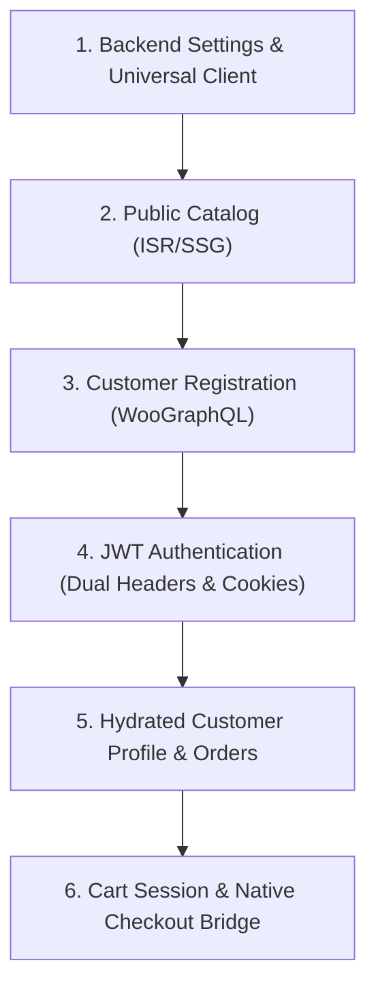

# Next.js WooCommerce Integration (`nextjs-woocommerce`)

Operational runbook and checklist for architecting, querying, and integrating Next.js App Router applications with a headless WooCommerce backend via WPGraphQL, WooGraphQL, and JWT Authentication.

---

## Prerequisites & Documentation References

- [ ] Next.js 14+ project initialized with App Router and TypeScript.
- [ ] Active WooCommerce backend with **WPGraphQL**, **WooGraphQL**, and **wp-graphql-jwt-authentication**.
- [ ] For complete API schemas and Next.js code patterns, consult [nextjs-woocommerce-reference.md](./references/nextjs-woocommerce-reference.md).
- [ ] For reusable data-fetching client implementation, see [woocommerce-fetcher.ts](./examples/woocommerce-fetcher.ts).

---

## Step-by-Step Implementation Checklist

### Phase 1: Environment & Universal Fetcher Setup
- [ ] **Configure Environment Variables**:
  - Add `NEXT_PUBLIC_WORDPRESS_API_URL=https://your-store.com/graphql` to `.env.example` and `.env.development`.
  - Add `NEXT_PUBLIC_WORDPRESS_URL=https://your-store.com` for checkout redirects.
- [ ] **Setup Universal Fetcher**:
  - Implement [woocommerce-fetcher.ts](./examples/woocommerce-fetcher.ts) supporting dual auth headers (`Authorization: Bearer` and `X-JWT-Auth`), ISR revalidation, and resilient response parsing (handling WordPress HTTP 403 status on valid data).

### Phase 2: Public Product Catalog & Taxonomies
- [ ] **Category Navigation**: Query `productCategories` with `hideEmpty: true` for headers and category menus.
- [ ] **Product Grid Archive**: Query `products` using polymorphic union fragments (`... on SimpleProduct`, `... on VariableProduct`). Configure `next: { revalidate: 300, tags: ['products'] }`.
- [ ] **Product Detail Page**: Pre-render dynamic routes (`app/products/[slug]/page.tsx`) with `generateStaticParams()` querying all product slugs.

### Phase 3: Customer Registration (Sign-Up)
- [ ] **Verify WordPress Backend Settings**:
  - `Settings → General`: Check **"Anyone can register"** and default role set to **Customer**.
  - `WooCommerce → Settings → Accounts & Privacy`: Check account creation on checkout and account pages; **uncheck** auto-generated password so users supply their own.
- [ ] **Registration Mutation**: Implement Server Action executing `registerCustomer(input: { username, email, password })`.
- [ ] **Feedback & Form Reset**: Format WordPress error strings (strip HTML tags) and auto-redirect to login or auto-authenticate.

### Phase 4: JWT Authentication Pipeline (Login & Logout)
- [ ] **Login Mutation**: Implement Server Action executing `login(input: { username, password })`.
- [ ] **Secure Cookie Storage**: Store returned `authToken` in secure `HttpOnly` cookie (`auth_token`, `SameSite=Lax`, `maxAge=7 days`).
- [ ] **Session Binding**: If customer returns `sessionToken`, store in `wc_session` cookie.
- [ ] **Client Redirection**: Navigate cleanly via `window.location.href = '/login'` on success to trigger Server Component cookie hydration.
- [ ] **Logout Action**: Delete `auth_token` and `wc_session` cookies and refresh the view.

### Phase 5: Protected User Profile & Orders
- [ ] **Combined Profile Query**: Query `viewer { id databaseId name email }` and `customer { id databaseId displayName email billing { ... } orders(first: 10) { nodes { ... } } }`.
- [ ] **Avoid Restricted Fields**: Do NOT query `capabilities` or `nicename` on non-admin customer tokens.
- [ ] **Flexible Session Check**: Validate session if either `viewer.id` or `customer.id !== 'guest'` is resolved.

### Phase 6: Cart Management & Native Checkout Bridge
- [ ] **Cart State**: Capture and persist `woocommerce-session` header returned on `addToCart` mutations.
- [ ] **Native Checkout Bridge**: Redirect users to `https://your-store.com/checkout` to leverage native WooCommerce payment gateways (ZarinPal, Mellat, Stripe) and compliance seals.

---

## Edge Cases & Known Pitfalls

1. **WordPress HTTP 403 on Valid Bearer Tokens**: WordPress core REST/security filters emit an HTTP 403 status header when non-admin Bearer tokens are sent. The fetcher must inspect and return `json.data` if present rather than discarding payloads solely based on `!res.ok`.
2. **Dual Auth Headers (`Authorization` + `X-JWT-Auth`)**: Many hosting providers (LiteSpeed, Apache, Hostinger) strip `Authorization` headers. Sending both `Authorization: Bearer <token>` and `X-JWT-Auth: <token>` guarantees authentication succeeds.
3. **Restricted `viewer` Fields**: Fields like `capabilities` and `nicename` require administrative capabilities in WPGraphQL. Including them in customer queries causes 403 permission failures or null viewer results.
4. **Registration Password Setting**: If WooCommerce setting "automatically generate an account password" is checked, user passwords submitted from Next.js will be ignored and replaced with emailed WordPress random strings. Always uncheck it.
5. **Static vs. Dynamic De-optimization**: Reading cookies in the root layout or product pages switches Next.js into full SSR dynamic mode. Only read auth cookies inside Server Actions, Route Handlers, or isolated account dashboard sub-trees (`app/login`, `app/account`).
6. **Polymorphic Fragments**: Direct queries like `products { nodes { price } }` will fail validation in WooGraphQL. Always wrap pricing and variations in `... on SimpleProduct` and `... on VariableProduct`.
7. **Session Loss**: When adding items to cart, failing to resend the `woocommerce-session` header creates a new empty cart on every mutation.

---

## Verification & Pre-flight Testing

- [ ] `pnpm build` succeeds with static generation of product pages.
- [ ] Customer sign-up creates customer entity in WooCommerce without errors.
- [ ] Login sets `auth_token` HttpOnly cookie and navigates to profile.
- [ ] Profile dashboard displays user name, customer ID, billing info, and recent orders.
- [ ] Log out clears cookies and renders login form.
