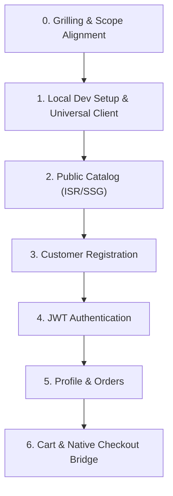

# Next.js WooCommerce Integration (`nextjs-woocommerce`)

Operational runbook for integrating a Next.js App Router storefront with a headless WooCommerce backend (WPGraphQL + WooGraphQL + JWT), from local orchestration to native checkout handoff.

---

## Prerequisites & References

- [ ] Next.js 14+ App Router project with TypeScript.
- [ ] Backend running WooCommerce, **WPGraphQL**, **WooGraphQL**, and **wp-graphql-jwt-authentication** (see the `headless-woocommerce-api` skill).
- [ ] [nextjs-woocommerce-reference.md](./references/nextjs-woocommerce-reference.md) — query, auth, and callback patterns.
- [ ] [windows-local-dev.md](./references/windows-local-dev.md) — Windows/Docker ports, Traefik, hosts, volumes, PDO patching.
- [ ] [verification-playbook.md](./references/verification-playbook.md) — copy-paste GraphQL and routing checks.
- [ ] [woocommerce-fetcher.ts](./examples/woocommerce-fetcher.ts) — universal resilient fetcher.
- [ ] [dev-traefik](./examples/dev-traefik/) and [docker-compose.local.yml](./examples/docker-compose.local.yml) — local orchestration templates.

---

## Step-by-Step Checklist

### Phase 0: Interactive Grilling & Scope Alignment (Mandatory First Step)

Before writing code, establish:

1. **Architecture** — single-domain reverse proxy (Traefik/Caddy) or decoupled origins? What are the local and production domains?
2. **Host** — Windows, macOS, or Linux? On Windows, is WSL2 healthy? (Port exclusions and bind-mount performance depend on this.)
3. **TLS** — trusted local certificate (mkcert) or Traefik self-signed default? Can the user accept a browser warning or elevate for a hosts edit?
4. **Catalog** — simple products only, or variable products with attributes? Variable products are required to validate `fill_cart`.
5. **Checkout** — native `/checkout` transfer via `fill_cart` (recommended for regional gateways) or the WooGraphQL `checkout` → `order-pay` mutation?
6. **Payments** — COD, ZarinPal sandbox, Zibal, or another gateway? Is a sandbox merchant code available?
7. **Persistence** — disposable local database or data that must survive container recreation?

### Phase 1: Local Development Environment & Universal Fetcher

- [ ] **Unified domain** — serve Next.js and WordPress on one host (`shop.local`, `shop.example.com`) to avoid third-party cookie blocking.
- [ ] **Traefik routing**:
  - WordPress router (`priority: 100`): `/checkout`, `/my-account`, `/wp-admin`, `/wp-login.php`, `/wp-content`, `/wp-includes`, `/wp-json`, `/graphql`, `QueryRegexp('wc-ajax', '.+')`, `QueryRegexp('wc-api', '.+')`.
  - **Do not route `/wc-api` to WordPress.** Let Next.js middleware 307 legacy callback URLs to `/checkout/?wc-api=...` (Phase 6).
  - Next.js router (`priority: 10`): catch-all for `/`, `/products`, `/cart`, `/_next/*`.
- [ ] **Dev server proxy** — run Next.js on the host and a Caddy/Nginx container on `my_network` forwarding to `host.docker.internal:<port>`.
- [ ] **Port selection** — on Windows, check `netsh interface ipv4 show excludedportrange protocol=tcp`. If 3000/3001 fall inside a reserved range (2929–3028 is common), use **4000** and update `package.json`, `playwright.config.ts`, `serverActions.allowedOrigins`, and the Caddy target together.
- [ ] **TLS** — for `.local`, use `tls=true` without a cert resolver (Traefik serves its default self-signed certificate). Keep `NODE_TLS_REJECT_UNAUTHORIZED=0` for development **and for build-time fetches** (`next build`); never in production.
- [ ] **Hosts entry** — add `127.0.0.1 shop.local` and `::1 shop.local` from an elevated shell; verify with `Resolve-DnsName shop.local`.
- [ ] **WordPress volumes** — named volumes for core and MySQL; bind-mount only `mu-plugins` and `uploads.ini` (see Windows reference).
- [ ] **WordPress constants** — `WORDPRESS_CONFIG_EXTRA` is evaluated at runtime by the official image, not only on first boot. Define `WP_HOME`, `WP_SITEURL`, `WP_ENVIRONMENT_TYPE=local`, `DISABLE_WP_CRON`, `WP_POST_REVISIONS=false`, `FORCE_SSL_ADMIN`, and **`GRAPHQL_JWT_AUTH_SECRET_KEY`** (the image does not auto-define arbitrary env vars).
- [ ] **Container patches** — `pdo_mysql` and WP-CLI live in the container layer and disappear on recreation. Run `patch-wordpress.ps1` after every `up`/`down`/image update; otherwise Persian WooCommerce returns HTTP 500 on `/wp-admin`.
- [ ] **Environment variables** — `.env.development`: `NEXT_PUBLIC_WORDPRESS_API_URL=https://shop.local/graphql`, `NEXT_PUBLIC_WORDPRESS_URL=https://shop.local`, `NEXT_PUBLIC_BASE_URL=https://shop.local`. `.env.example`: production URLs.
- [ ] **Universal fetcher** — dual auth headers (`Authorization` + `X-JWT-Auth`), optional `woocommerce-session`, ISR revalidation, and return `json.data` even when WordPress emits HTTP 403.

### Phase 2: Public Catalog & Taxonomies

- [ ] Query `productCategories(hideEmpty: true)` for navigation.
- [ ] Query `products` with polymorphic fragments (`... on SimpleProduct`, `... on VariableProduct`); never query `price`/`variations` on the base `Product`.
- [ ] Use `next: { revalidate: 300, tags: ['products'] }` for public catalog data.
- [ ] Decode HTML entities in `price` (`&nbsp;`, currency symbol) before rendering; do not assume a plain numeric string.
- [ ] Pre-render `app/products/[slug]/page.tsx` with `generateStaticParams()` when the route does not read cookies.

### Phase 3: Customer Registration

- [ ] WordPress: enable registration, set default role **Customer**, disable auto-generated passwords.
- [ ] Implement `registerCustomer(input: { username, email, password })` in a Server Action.
- [ ] Strip HTML from WordPress errors and redirect to login (or auto-authenticate) on success.
- [ ] **WooGraphQL caveat**: the registration payload can return `databaseId`, `email`, and `displayName` as `null` even though the customer was created. Re-query `customer`/`viewer` after login instead of relying on those fields.

### Phase 4: JWT Authentication Pipeline

- [ ] Login mutation: `login(input: { username, password })` returns `authToken`, `refreshToken`, and `customer.sessionToken`.
- [ ] Store `authToken` in a secure `HttpOnly` cookie (`SameSite=Lax`, 7 days).
- [ ] Store `sessionToken` in a `wc_session` cookie when present.
- [ ] Send both `Authorization: Bearer` and `X-JWT-Auth` headers.
- [ ] **Expiry**: the plugin defaults to 300 seconds. `graphql_jwt_auth_expire` expects a **lifetime in seconds** (e.g. `DAY_IN_SECONDS`), not a timestamp. Extend only for local development.
- [ ] Logout clears both cookies and refreshes the view.

### Phase 5: Protected Profile & Orders

- [ ] Query `viewer { id databaseId name email }` and `customer { id databaseId displayName email billing { ... } orders(first: 10) { ... } }`.
- [ ] Do not query `capabilities` or `nicename` on customer tokens.
- [ ] Treat the session as valid when either `viewer.id` or a non-guest `customer.id` resolves.

### Phase 6: Cart & Native Checkout Bridge

- [ ] Capture and resend the `woocommerce-session` header on every cart mutation; send it as `Session <token>`.
- [ ] Include `variation { node { id databaseId name price regularPrice salePrice } }` in `GET_CART_QUERY`.
- [ ] Redirect to `/checkout/?fill_cart=productId:qty:variationId,...` (never `?add-to-cart=` for variable products). Process `fill_cart` in `mu-plugins/headless-redirects.php` on `template_redirect` priority `1`, call `WC()->session->set_customer_session_cookie(true)`, and save session data before `wp_safe_redirect(wc_get_checkout_url())`.
- [ ] Alternative: WooGraphQL `checkout` mutation with `isPaid: false` → `/checkout/order-pay/<id>/?pay_for_order=true&key=<order_key>`.
- [ ] **Gateway callbacks**:
  - `next.config.ts`: `skipTrailingSlashRedirect: true` so POST callbacks ending in `/` reach middleware instead of a 308.
  - `middleware.ts`: method-preserving 307 from `/wc-api/*`, `/index.php/wc-api/*`, and `?wc-api=*` to `/checkout/?wc-api=...` with `Cache-Control: no-store`.
  - `headless-redirects.php`: filter `woocommerce_api_request_url` to emit `/checkout/?wc-api=<Gateway>`.
  - Keep `/wc-api` **out** of the WordPress Traefik rule; `QueryRegexp('wc-api', '.+')` still routes `/checkout?wc-api=...` to WordPress.
- [ ] Filter `woocommerce_ajax_get_endpoint` to `/checkout/?wc-ajax=<endpoint>` so classic checkout AJAX does not hit the Next.js root route.
- [ ] Block-based checkout does not use `wc-ajax`; verify its cart through `/wp-json/wc/store/v1/cart` with the browser cookie jar.

---

## Edge Cases & Known Pitfalls

1. **HTTP 403 with valid Bearer tokens** — inspect and return `json.data` when present; do not discard the payload solely because `!res.ok`.
2. **Dual auth headers** — send both `Authorization` and `X-JWT-Auth`; some hosts strip one.
3. **Cross-origin empty cart** — use the native checkout bridge or parameterized cart URLs; third-party cookies are blocked across origins.
4. **JWT expiry** — expired tokens cause 403s on cart mutations; check `exp` and refresh.
5. **Restricted viewer fields** — `capabilities` and `nicename` require admin capabilities.
6. **Registration password setting** — "automatically generate an account password" overrides the submitted password.
7. **Static vs dynamic** — reading cookies in the root layout or product pages de-opts them to SSR; keep auth reads inside account/login subtrees.
8. **Polymorphic fragments** — product pricing and variations require inline fragments.
9. **Session loss** — failing to resend `woocommerce-session` creates a new empty cart per mutation.
10. **SPA interception of backend redirects** — use absolute URLs with trailing slashes for WordPress paths; render them as plain `<a>` tags.
11. **Account dashboard lock-in** — hook `template_redirect` to send logged-in `/my-account/` visitors to Next.js `/account`.
12. **`redirect_to` loss** — inject hidden `redirect_to` fields in WooCommerce login/register forms; prioritize it in `woocommerce_login_redirect`.
13. **Windows Docker I/O** — named volumes for core/MySQL, bind only active folders; define `DISABLE_WP_CRON` and `WP_POST_REVISIONS=false`.
14. **Dormant Iranian gateways** — use sandbox or COD locally; live terminals are required for real transactions.
15. **Variable checkout loops** — `?add-to-cart=` fails without variation attributes; use `fill_cart`.
16. **Container recreation loses `pdo_mysql` and WP-CLI** — re-run `patch-wordpress.ps1`; the symptom is `could not find driver` and HTTP 500 on `/wp-admin`.
17. **JWT filter units** — returning `time() + DAY_IN_SECONDS` from `graphql_jwt_auth_expire` produces a ~56-year token; return seconds only.
18. **Registration payload nulls** — re-query the customer after registration.
19. **Price HTML entities** — `price` contains `&nbsp;` and the currency symbol; decode before display.
20. **Empty checkout 302** — an empty native cart redirects `/checkout/` to `/cart/`; that is expected. Populate with `fill_cart` before asserting checkout HTML.
21. **Build-time TLS** — self-signed local certs break `next build` fetches unless `NODE_TLS_REJECT_UNAUTHORIZED=0` is set for the build.
22. **WP-CLI absent or root-owned** — install it on the host and `docker cp` the phar; run WP-CLI as `www-data` (`docker exec -u www-data`) to keep volume ownership.
23. **Apache error log hangs** — `/var/log/apache2/error.log` is symlinked to stderr; use `docker logs <container>` instead of `tail`.

---

## Verification & Pre-flight Testing

- [ ] `https://shop.local/products` returns 200 and renders seeded products (`API Connected`).
- [ ] `pnpm build` succeeds (set local `NEXT_PUBLIC_*` values and the TLS override for the build).
- [ ] Login mutation returns `authToken`; the login page sets the `auth_token` cookie and reaches `/account`.
- [ ] Registration creates a customer with the `customer` role.
- [ ] Profile query resolves viewer and customer data, including billing and orders.
- [ ] `addToCart` returns `woocommerce-session`; a follow-up cart query with that header retains the item.
- [ ] `/wc-api/<Gateway>/` returns 307 to `/checkout/?wc-api=<Gateway>` (including POST and trailing slash).
- [ ] `?wc-ajax=` reaches WordPress, not Next.js HTML.
- [ ] `/wp-admin/` returns 200 after login (no `could not find driver`).
- [ ] Full command set: [verification-playbook.md](./references/verification-playbook.md).
