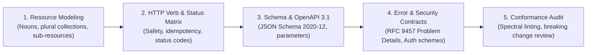

# Universal REST API Design Standard (`rest-api-design`)

A framework-agnostic architectural standard for designing, specifying, and auditing production RESTful APIs adhering to the [OpenAPI Specification 3.1](https://spec.openapis.org/oas/latest.html) and IETF RFC standards.

---

## 5-Phase API Design Lifecycle

### Phase 1: Resource Modeling & URI Architecture
1. Identify primary domain resources and pluralize collection paths (`/orders`, `/users`, not `/getOrders`).
2. Structure 1-to-N relationships hierarchically up to 2 levels maximum (`/tenants/{id}/users`).
3. Model state transitions or non-CRUD operations using the sub-resource controller pattern (`POST /orders/{id}/cancel`).
4. Apply standard query parameters for filtering, sorting (`?sort=-createdAt`), and pagination (cursor or offset).
5. Consult the [Resource Modeling & URI Conventions Guide](./references/resource-modeling-and-uris.md).

### Phase 2: HTTP Verbs, Idempotency & Status Codes
1. Enforce strict HTTP method semantics (`GET` safe/idempotent, `PUT` full replace, `PATCH` partial update, `DELETE` remove).
2. Assign canonical status codes: `200 OK`, `201 Created` with `Location` header, `204 No Content`, `400`, `401`, `403`, `404`, `409`, `422`, `429`, and `500`.
3. Support optimistic locking on concurrent updates via `ETag` and `If-Match`.
4. Consult the [HTTP Methods & Status Codes Matrix](./references/http-methods-and-status-codes.md).

### Phase 3: Schema Modeling & OpenAPI 3.1 Authoring
1. Author specifications targeting **OpenAPI 3.1.0** utilizing full JSON Schema 2020-12 support (`type: ["string", "null"]`).
2. Separate entities into clear DTO contracts: Entity schemas, Creation inputs (`omit id, createdAt`), and Update inputs.
3. Start from the production-ready starter template in [openapi-v3.1.template.yaml](./resources/templates/openapi-v3.1.template.yaml) and [api-design-spec.template.md](./resources/templates/api-design-spec.template.md).
4. Review structure nuances in the [OpenAPI 3.1 Architecture Guide](./references/openapi-3-1-spec-structure.md).

### Phase 4: Standard Error Envelopes & Security
1. Format all client and server error responses as **RFC 9457 Problem Details** (`application/problem+json`).
2. For `422 Unprocessable Content` validation errors, return detailed `invalid_params: [{ name, reason }]` arrays.
3. Define global security schemes under `components.securitySchemes` (Bearer JWT, API Key, or OAuth2).
4. Review the [RFC 9457 Problem Details Reference](./references/rfc9457-problem-details.md) and schema in [problem-details.schema.yaml](./resources/templates/problem-details.schema.yaml).

### Phase 5: Versioning, Evolution & Verification
1. Adopt URI path versioning (`/api/v1/`) for public APIs to maximize client clarity and CDN caching.
2. Adhere to non-breaking evolution rules (additive changes only; deprecate with RFC 8594 `Sunset` headers).
3. Review the [API Versioning & Deprecation Guide](./references/versioning-and-evolution.md).
4. Inspect the complete real-world reference implementation in [order-management-api.openapi.yaml](./examples/order-management-api.openapi.yaml).
