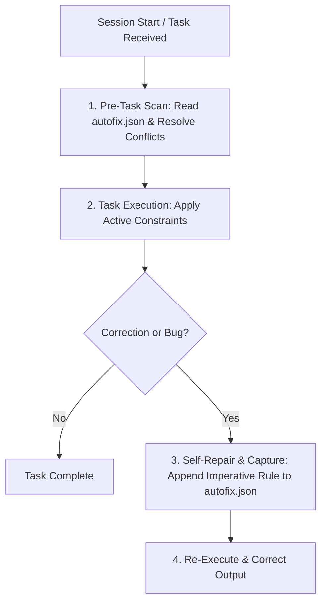

# Self-Repair (Self-Correcting Rules Engine)

A self-correcting memory and learning engine that records corrections, project conventions, and bug fixes into a persistent ruleset file (`autofix.json`). Must always be loaded at session start and consulted before starting any task to apply active constraints, and triggered immediately whenever the user provides any correction, preference, or criticism, or when a bug is diagnosed.

**Why this works:** AI agents tend to repeat the same default assumptions or stylistic errors across fresh sessions. By externalizing learned knowledge into an imperative, versioned JSON ruleset with strict precedence (newer rules win), the agent retains hard boundaries tailored to the specific user and repository.

---

## Storage & Configuration

The skill looks for the ruleset file in one of the following locations (in order of priority):

1. `.agents/autofix.json`
2. `autofix.json` (at workspace root)
3. `.rules/autofix.json`

If none exists when a new rule needs to be added, it creates `.agents/autofix.json` (or root `autofix.json` depending on project convention).

### Rule Schema

Each rule is stored inside a JSON array with the following schema:

```json
[
  {
    "Rule_number": 1,
    "Category": "CODE",
    "Instruction": "Never use default exports for React components - always use named exports.",
    "Why": "Ensures consistency with the codebase and simplifies refactoring.",
    "Issue": "#42"
  }
]
```

> [!NOTE]
> The `"Issue"` field is optional and references the GitHub Issue (e.g. `"#42"` or issue URL) where this bug or rule was diagnosed, verified, and triaged. See `github-triage`.

### Allowed Categories

| Category    | Description                                                          | Examples                                                            |
| ----------- | -------------------------------------------------------------------- | ------------------------------------------------------------------- |
| `[STYLE]`   | Code formatting, naming conventions, import ordering, comments       | "Always use camelCase for helper functions"                         |
| `[CODE]`    | Language patterns, library choices, type definitions, error handling | "Never use `any` in TypeScript; use `unknown` with type guards"     |
| `[ARCH]`    | Directory structure, module boundaries, architectural layers         | "API routes live in `src/server/routes/`, not `src/api/`"           |
| `[TOOL]`    | CLI commands, build tools, package managers, testing frameworks      | "Always use `pnpm` instead of `npm` or `yarn`"                      |
| `[PROCESS]` | Git workflow, commit messages, PR requirements, test gates           | "Never add emojis to commit messages"                               |
| `[DATA]`    | Database schemas, migrations, caching strategies, state shapes       | "Always include `created_at` and `updated_at` timestamps on tables" |
| `[UX]`      | UI behaviors, copy conventions, accessibility standards              | "Always provide an explicit `aria-label` for icon-only buttons"     |
| `[OTHER]`   | General project or domain-specific preferences                       | "Always document public API endpoints in markdown table format"     |

---

## Operational Workflow



---

## Detailed Step-by-Step Execution

### 1. Pre-Task Scan (Before Doing Anything)

Before planning or modifying files in any task:

1. **Locate and load `autofix.json`**.
2. **Scan the rules**:
   - Check if any rule directly applies to the files, tools, or patterns involved in the current prompt.
3. **Resolve conflicts**:
   - If two rules give conflicting guidance, the **higher-numbered (newer) rule wins**.
4. **Hold constraints active**:
   - Treat all active rules as hard constraints (equivalent to prompt contract `CONSTRAINTS`).

---

### 2. When to Add a Rule (Trigger Conditions)

Immediately trigger rule capture when any of the following happens:

- **User explicitly corrects output**: e.g., _"No, don't use X, do it with Y"_, _"We don't use class components here"_.
- **User rejects a file, approach, or pattern**: e.g., _"Don't put test files next to source code"_.
- **User states a personal/team preference**: e.g., _"Always format commit messages as Conventional Commits"_, _"Never use emojis in docs"_.
- **A bug was caused by wrong assumptions**: Agent assumed a library or file location that caused a failure.
- **User runs `/learn` or asks to remember a rule**.

---

### 3. Appending a New Rule

When a trigger occurs, perform the following atomic update:

1. Read the existing `autofix.json` array.
2. Determine the next sequential `Rule_number`:
   - If the highest existing rule number is $N$, the new rule is $N + 1$.
   - If the file is empty or new, start at `1`.
3. Format the new rule object:
   - **Rule_number**: Sequential integer.
   - **Category**: One of the standard categories (`STYLE`, `CODE`, `ARCH`, `TOOL`, `PROCESS`, `DATA`, `UX`, `OTHER`).
   - **Instruction**: Written in strict imperative format: `"Never/Always do X - because Y."`
   - **Why**: Brief reason (e.g. _"user preference"_, _"codebase pattern"_, _"framework limitation"_).
   - **Issue**: Optional GitHub Issue reference (e.g. `"#42"`), populated when triaged via `github-triage`.
4. Append the rule into the JSON array and save the file formatted with 2-space indentation.
5. **Deduplicate & Consolidate**: Merge overlapping or superseded rules in the same domain and keep `Rule_number` sequentially ordered (`1..N`) so `autofix.json` stays free of duplicates. When any skill in `.agents/skills/` is updated, sync it to `d:/Scripts/Obsidian/skills/`.
6. Briefly notify the user:
   > _"Learned rule #`<N>` (`[CATEGORY]`): `<Instruction>` — recorded in `autofix.json`."_

---

### 4. Example Rules File (`autofix.json`)

```json
[
  {
    "Rule_number": 1,
    "Category": "PROCESS",
    "Instruction": "Never add emojis to commit messages - keep commit titles plain Conventional Commits.",
    "Why": "user preference"
  },
  {
    "Rule_number": 2,
    "Category": "ARCH",
    "Instruction": "Always place API route handlers in 'src/server/routes/', never in 'src/api/' - maintain consistent backend architecture.",
    "Why": "existing codebase pattern"
  },
  {
    "Rule_number": 3,
    "Category": "CODE",
    "Instruction": "Always use Zod schemas for input validation on all external entry points - prevent untyped runtime inputs.",
    "Why": "prevents runtime errors and enforces types",
    "Issue": "#14"
  }
]
```

---

## Best Practices & Edge Cases

- **Atomic JSON Writing**: Always parse the existing JSON array, append the new object, and write back valid JSON. Never corrupt the file with unescaped text.
- **Concrete & Imperative**: Write rules that another AI can follow unambiguously. Avoid vague advice like _"Write clean code"_; prefer _"Always export types alongside component implementations in `.types.ts` files"_.
- **No Infinite Loops**: When recording a rule, do not trigger a separate self-repair loop for the rule file itself.
- **Superseding Rules**: If Rule 1 says _"Use Axios"_ and the user later instructs _"Migrate everything to Fetch"_, add Rule 4 _"Always use native Fetch instead of Axios"_ with `Why: "user requested migration to native fetch (supersedes Rule 1)"`.
