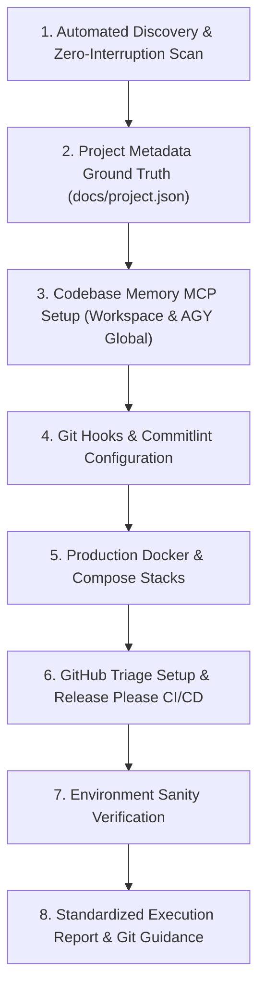

# Universal Repository Setup & Environment Skill (`setup-repository`)

Establishes, configures, and validates the standard development environment for any software repository, covering project metadata (`docs/project.json`), code intelligence (`codebase-memory-mcp`), Git hooks (`husky` & `commitlint`), GitHub triage infrastructure (`.github/ISSUE_TEMPLATE/` & triage labels), production Docker containerization, and credit-optimized Release Please CI/CD.

---

## Workflow Overview



---

## Step 1: Automated Discovery & Repository Scan (Zero Interruption Rule)

> [!IMPORTANT]
> **DO NOT PROMPT THE USER IF INFORMATION IS AVAILABLE IN REPOSITORY FILES.**
> Scan repository files, lockfiles, and `docs/` first. Only prompt the user for missing or ambiguous configuration.

1. **Detect Framework, Runtime & Package Manager**:
   - Inspect `package.json`, `pyproject.toml`, `Cargo.toml`, `go.mod`, or `pubspec.yaml`.
   - Deduce package manager from lockfiles (`pnpm-lock.yaml` -> `pnpm`, `bun.lockb` -> `bun`, `yarn.lock` -> `yarn`, `package-lock.json` -> `npm`).
2. **Scan Existing Documentation**:
   - Read `CONTEXT.md`, `docs/plan.md`, `docs/adr/*.md`, and `README.md`.
3. **Interactive Clarification**:
   - If runtime, test command, build command, or release target cannot be determined from existing files, ask focused questions before scaffolding.

---

## Step 2: Project Metadata Ground Truth (`docs/project.json`)

Create or update `docs/project.json` with discovered project metadata:

```json
{
  "project_context_and_metadata": {
    "project_name": "my-project",
    "runtime": "node",
    "package_manager": "pnpm",
    "source_dir": "src",
    "test_command": "pnpm test",
    "build_command": "pnpm run build",
    "testing_library": ["jest", "playwright"],
    "containerization": "docker-standalone",
    "ci_cd_provider": "github-actions",
    "release_automation": "release-please",
    "publish_target": "container"
  }
}
```

---

## Step 3: Setup `codebase-memory-mcp` Code Intelligence Server

1. **Install & Register `codebase-memory-mcp`**:
   - Register in workspace `mcp.json` (and `.agents/mcp_config.json` if present).
   - Register globally **strictly for Google Antigravity (AGY) only** in `~/.gemini/antigravity/mcp_config.json` and `~/.gemini/config/mcp_config.json`.
2. **Stutter Prevention & Exclusions**:
   - Deploy [`cbmignore.template`](./resources/templates/cbmignore.template) to `<repo>/.cbmignore`.
   - Disable automatic session file-watching globally: `codebase-memory-mcp config set auto_watch false`.
   - Add `.codebase-memory/` to `.gitignore`.
3. **Initial On-Demand Indexing**:
   - Run `codebase-memory-mcp cli index_repository --repo-path "<canonical-repo-path>" --mode moderate`.
   - Consult [codebase-memory-and-mcp.md](./references/codebase-memory-and-mcp.md) for full installation and configuration details.

---

## Step 4: Setup Git Hooks with Husky & Commitlint

1. Install dev dependencies: `pnpm add -D husky @commitlint/cli @commitlint/config-conventional`.
2. Configure `commitlint.config.mjs` extending `@commitlint/config-conventional`.
3. Initialize Husky (`pnpm exec husky init`) and configure:
   - `.husky/commit-msg`: `pnpm exec commitlint --edit $1`
   - `.husky/pre-push`: `pnpm run test:all` (ensure `--passWithNoTests` is set so empty test suites do not block pushes; never create dummy test files).

---

## Step 5: Setup Multi-Stage Production Docker Containerization

1. Configure `.dockerignore` excluding `node_modules/`, `.env*`, `.git/`, build caches, and `.codebase-memory/`.
2. Deploy multi-stage production [`Dockerfile.template`](./resources/templates/Dockerfile.template).
3. Deploy [`docker-compose.yml.template`](./resources/templates/docker-compose.yml.template) and [`docker-compose.prod.yml.template`](./resources/templates/docker-compose.prod.yml.template).
4. Review specifications in [docker-and-cicd-guide.md](./references/docker-and-cicd-guide.md).

---

## Step 6: Setup GitHub Triage Infrastructure & Credit-Optimized CI/CD

1. **GitHub Triage Infrastructure Setup**:
   - Execute [`init_triage_infra.ps1`](./scripts/init_triage_infra.ps1) to scaffold `.github/ISSUE_TEMPLATE/bug_report.yml` (from [bug_report.yml.template](./resources/templates/bug_report.yml.template)) and `.github/ISSUE_TEMPLATE/config.yml` (from [issue_config.yml.template](./resources/templates/issue_config.yml.template)), and provision remote triage labels (`bug`, `agent-triage`, `self-repair`, `verified`) for `github-triage`.
2. **Release Please & Multi-Arch CI/CD**:
   - Deploy [`.github/workflows/release-please.yml`](./resources/templates/release-please.yml.template) with `concurrency.cancel-in-progress: false`, native AMD64/ARM64 matrix runners, digest manifest merging, and lowercase OCI image names.
   - Consult [docker-and-cicd-guide.md](./references/docker-and-cicd-guide.md) for full workflow architecture.

---

## Step 7: Environment Sanity Verification

- [ ] `docs/project.json` exists with valid schema.
- [ ] `mcp.json` and AGY global `mcp_config.json` contain `codebase-memory`.
- [ ] `<repo>/.cbmignore` exists and `codebase-memory-mcp config get auto_watch` returns `false`.
- [ ] `.codebase-memory/` is in `.gitignore` and `codebase-memory-mcp cli get_architecture` succeeds.
- [ ] Commitlint and `.husky/commit-msg` / `.husky/pre-push` are configured.
- [ ] `.github/ISSUE_TEMPLATE/bug_report.yml` and `.github/ISSUE_TEMPLATE/config.yml` exist.
- [ ] Docker configuration (`docker compose config`) and `.github/workflows/release-please.yml` are valid.

---

## Step 8: Standardized Dev Setup Execution Report & Git Commit Protocol

Always output the standardized execution report upon completion:

```markdown
## 🛠️ Repository Setup Execution Report

| Step / Component                     | Target File(s) / Resource                                                             | Status                          | Notes / Details                                                                   |
| :----------------------------------- | :------------------------------------------------------------------------------------ | :------------------------------ | :-------------------------------------------------------------------------------- |
| **1. Project Metadata**              | `docs/project.json`                                                                   | `[IMPLEMENTED]` / `[UNTOUCHED]` | Recorded runtime, package manager, and test tooling metadata.                     |
| **2. Codebase Memory MCP**           | `mcp.json`, `.cbmignore`, AGY global configs (`auto_watch=false`)                     | `[IMPLEMENTED]` / `[UNTOUCHED]` | Binary installed, registered in workspace & globally for AGY only, indexed graph. |
| **3. Husky Git Hooks**               | `.husky/commit-msg`, `.husky/pre-push`                                                | `[IMPLEMENTED]` / `[UNTOUCHED]` | Configured Conventional Commits gate and pre-push test suite runner.              |
| **4. Commitlint Config**             | `commitlint.config.mjs`                                                               | `[IMPLEMENTED]` / `[UNTOUCHED]` | Enforces `@commitlint/config-conventional` specification.                         |
| **5. Docker Containerization**       | `Dockerfile`, `docker-compose.yml`, `docker-compose.prod.yml`, `.dockerignore`        | `[IMPLEMENTED]` / `[UNTOUCHED]` | Multi-stage production container & local/GHCR compose stacks.                     |
| **6. GitHub Triage Infrastructure**  | `.github/ISSUE_TEMPLATE/bug_report.yml`, `.github/ISSUE_TEMPLATE/config.yml`, Labels  | `[IMPLEMENTED]` / `[UNTOUCHED]` | Scaffolded issue templates and synced `bug`, `agent-triage`, `self-repair`, `verified` labels. |
| **7. Release Please & Multi-Arch**   | `.github/workflows/release-please.yml`                                                | `[IMPLEMENTED]` / `[UNTOUCHED]` | Automated SemVer release PRs and native AMD64/ARM64 GHCR deployment.              |
| **8. Environment Sanity Check**      | Workspace Audit                                                                       | `[PASSED]`                      | All configuration files, issue templates, and hooks verified clean.               |
```

### Git Commit Instructions

Output the exact git commands and leave committing to the user:

```bash
git add docs/project.json mcp.json .cbmignore commitlint.config.mjs .husky/ Dockerfile docker-compose*.yml .github/ISSUE_TEMPLATE/ .github/workflows/
git commit -m "chore: configure standard repository tooling, github triage, codebase intelligence, and ci/cd"
```
